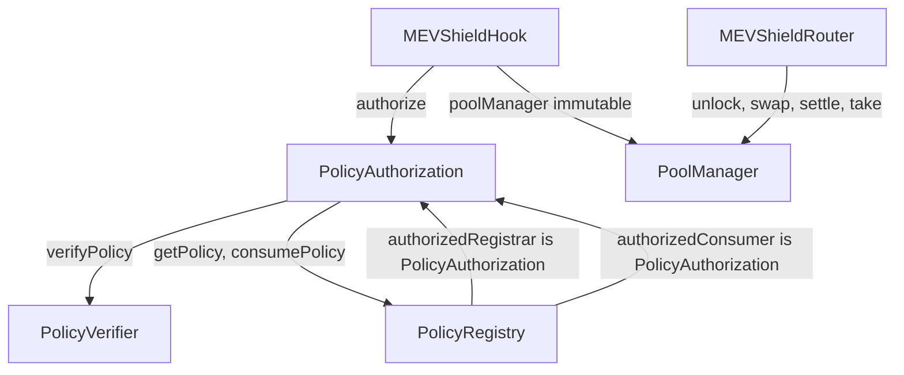

# Contracts

All contracts live in `src/` and are written for Solidity `0.8.26` with the `cancun` EVM target, as pinned in [foundry.toml](../../foundry.toml#L1). Six contracts are in the source directory; five are part of the deployed MEVShield stack and one is a deployment helper.

| File | Contract | Deployed | Role |
| --- | --- | --- | --- |
| `src/PolicyRegistry.sol` | `PolicyRegistry` | Yes | Stores the reduced policy record and the consumed-nonce table |
| `src/PolicyVerifier.sol` | `PolicyVerifier` | Yes | EIP-712 domain, type hash, signer recovery, authorized signer storage |
| `src/PolicyAuthorization.sol` | `PolicyAuthorization` | Yes | Verifies a signed policy against the registry and consumes it |
| `src/MEVShieldHook.sol` | `MEVShieldHook` | Yes | Uniswap v4 hook. The policy check point for swaps |
| `src/MEVShieldRouter.sol` | `MEVShieldRouter` | Yes | Execution router. Unlock, swap, minimum-output check, settlement |
| `src/CheckPoolId.sol` | `CheckPoolId` | No | Foundry script that recomputes a pool id and compares it to a literal |

`src/CheckPoolId.sol` extends `forge-std/Script`, holds a hard-coded pool key and expected pool id, and reverts when they disagree ([src/CheckPoolId.sol:10](../../src/CheckPoolId.sol#L10)). It is a diagnostic, not a contract in the deployed system.

## Contract relationships



The deployed wiring is: `PolicyRegistry.authorizedConsumer` equals the `PolicyAuthorization` address, `PolicyAuthorization.registry` and `.verifier` point at the registry and verifier, `MEVShieldHook.authorization` points at `PolicyAuthorization`, and `PolicyRegistry.authorizedRegistrar` is set to `PolicyAuthorization` so that user registrations go through signature verification ([script/DeploySepolia.s.sol:67](../../script/DeploySepolia.s.sol#L67) to [script/DeploySepolia.s.sol:72](../../script/DeploySepolia.s.sol#L72)). The local script differs in one respect: `DeployLocal` sets the registrar to the deployer, not to the authorization contract ([script/DeployLocal.s.sol:57](../../script/DeployLocal.s.sol#L57)). The frontend reads the hook's two immutables, the authorization's `registry` and `verifier`, and the verifier's `authorizedSigner`, then requires the pool manager, authorization, registry, verifier and signer addresses to equal its constants ([frontend/src/hooks/useProtocol.ts:38](../../frontend/src/hooks/useProtocol.ts#L38), comparison at [frontend/src/hooks/useProtocol.ts:106](../../frontend/src/hooks/useProtocol.ts#L106)). It refuses to create a policy when the registry consumer and the authorization address differ ([frontend/src/hooks/usePolicy.ts:295](../../frontend/src/hooks/usePolicy.ts#L295)).

## PolicyRegistry

`src/PolicyRegistry.sol`

### Responsibility

Owns two pieces of durable state: the stored policy record keyed by `policyId`, and two nonce bitmaps per trader, one for registration and one for consumption. It is the only contract that decides whether a nonce has been used.

### Immutables and storage

No immutables. Mutable state:

| Name | Type | Meaning |
| --- | --- | --- |
| `owner` | `address` | Set to the deployer in the constructor ([src/PolicyRegistry.sol:72](../../src/PolicyRegistry.sol#L72)) |
| `authorizedConsumer` | `address` | The only address allowed to call `consumePolicy` |
| `authorizedRegistrar` | `address` | The only address allowed to call `registerPolicy` |
| `policies` | `mapping(bytes32 => Policy)` | Private. Read through `getPolicy` |
| `registeredNonces` | `mapping(address => mapping(uint256 => bool))` | Private. Read through `isRegistered` |
| `consumedNonces` | `mapping(address => mapping(uint256 => bool))` | Public getter, also read through `isConsumed` |

### Stored struct

```solidity
struct Policy {
    bytes32 poolId;
    address trader;
    uint256 nonce;
    uint256 expiry;
    uint256 maxLoss;
    uint256 maxFee;
    uint256 minAmountOut;
}
```

Declared at [src/PolicyRegistry.sol:5](../../src/PolicyRegistry.sol#L5). Seven fields. Direction, amount and price limit are not stored. See [data model](data-model.md) for why this matters.

### External surface

| Function | Visibility | Access | Notes |
| --- | --- | --- | --- |
| `setAuthorizedConsumer(address)` | external | `onlyOwner` | Rejects the zero address. Emits `AuthorizedConsumerUpdated` ([src/PolicyRegistry.sol:75](../../src/PolicyRegistry.sol#L75)) |
| `setAuthorizedRegistrar(address)` | external | `onlyOwner` | Rejects the zero address. Emits `AuthorizedRegistrarUpdated` ([src/PolicyRegistry.sol:87](../../src/PolicyRegistry.sol#L87)) |
| `registerPolicy(bytes32,address,uint256,uint256,uint256,uint256,uint256)` | external | `onlyAuthorizedRegistrar` | Returns `policyId`. Emits `PolicyRegistered` ([src/PolicyRegistry.sol:96](../../src/PolicyRegistry.sol#L96)) |
| `getPolicy(bytes32)` | external view | anyone | Returns the stored record, or a zero struct when absent ([src/PolicyRegistry.sol:138](../../src/PolicyRegistry.sol#L138)) |
| `isRegistered(address,uint256)` | external view | anyone | Registration nonce lookup ([src/PolicyRegistry.sol:142](../../src/PolicyRegistry.sol#L142)) |
| `isConsumed(address,uint256)` | external view | anyone | Consumption nonce lookup ([src/PolicyRegistry.sol:146](../../src/PolicyRegistry.sol#L146)) |
| `consumePolicy(bytes32)` | external | `onlyAuthorizedConsumer` | Marks the nonce consumed ([src/PolicyRegistry.sol:150](../../src/PolicyRegistry.sol#L150)) |

`registerPolicy` validation, in order: non-zero `poolId`, non-zero `trader`, `expiry > block.timestamp`, and the `(trader, nonce)` pair not already registered ([src/PolicyRegistry.sol:105](../../src/PolicyRegistry.sol#L105) to [src/PolicyRegistry.sol:119](../../src/PolicyRegistry.sol#L119)). `maxLoss`, `maxFee` and `minAmountOut` are not range-checked.

`consumePolicy` validation, in order: the record exists (`trader != address(0)`), `block.timestamp < expiry`, and the nonce has not already been consumed ([src/PolicyRegistry.sol:153](../../src/PolicyRegistry.sol#L153) to [src/PolicyRegistry.sol:162](../../src/PolicyRegistry.sol#L162)). It then sets the consumed flag. It does not delete the record, so `getPolicy` keeps returning the policy after consumption.

### Events

- `PolicyRegistered(bytes32 indexed policyId, bytes32 indexed poolId, address indexed trader, uint256 nonce, uint256 expiry, uint256 maxLoss, uint256 maxFee, uint256 minAmountOut)` ([src/PolicyRegistry.sol:36](../../src/PolicyRegistry.sol#L36))
- `AuthorizedConsumerUpdated(address indexed oldConsumer, address indexed newConsumer)` ([src/PolicyRegistry.sol:47](../../src/PolicyRegistry.sol#L47))
- `AuthorizedRegistrarUpdated(address indexed oldRegistrar, address indexed newRegistrar)` ([src/PolicyRegistry.sol:48](../../src/PolicyRegistry.sol#L48))

### Errors

`Unauthorized`, `InvalidConsumer`, `InvalidRegistrar`, `PolicyAlreadyConsumed`, `PolicyNotFound`, `PolicyExpired`, `InvalidPool`, `InvalidTrader`, `InvalidExpiry`, `NonceAlreadyRegistered` ([src/PolicyRegistry.sol:25](../../src/PolicyRegistry.sol#L25) to [src/PolicyRegistry.sol:34](../../src/PolicyRegistry.sol#L34)).

`InvalidConsumer` and `InvalidRegistrar` are declared and used by the setter guards. All ten are reachable.

### Governance notes

`setAuthorizedConsumer` can be called repeatedly by the owner, with no delay and no two-step handover. Whoever controls `owner` can point the consumer at a new contract at any time, including a contract that consumes policies for an arbitrary caller. `setAuthorizedRegistrar` has the same shape. There is no timelock and no event-driven check that would delay a rotation. There is also no cancel function: a registered, unexpired policy stays executable until it is consumed or expires.

## PolicyVerifier

`src/PolicyVerifier.sol`

### Responsibility

Holds the EIP-712 domain and the ten-field policy type, recovers the signer from a signature, and stores the single address whose signatures count.

### Immutables and storage

No immutables. Mutable state: `owner` (constructor sender, [src/PolicyVerifier.sol:42](../../src/PolicyVerifier.sol#L42)) and `authorizedSigner` (initially zero). `POLICY_TYPEHASH` is a `public constant` ([src/PolicyVerifier.sol:21](../../src/PolicyVerifier.sol#L21)).

The domain is fixed at deployment: `EIP712("MEVShield", "1")`, so the name is `MEVShield` and the version is `1`. The chain id and verifying contract come from the deployment context, which is why a signature produced for one chain or one verifier address fails on another. `test/PolicyVerifier.t.sol` covers both cases.

### Full ten-field struct

```solidity
struct Policy {
    bytes32 poolId;
    address trader;
    uint256 nonce;
    uint256 expiry;
    uint256 maxLoss;
    uint256 maxFee;
    bool zeroForOne;
    int256 amountSpecified;
    uint160 sqrtPriceLimitX96;
    uint256 minAmountOut;
}
```

Declared at [src/PolicyVerifier.sol:8](../../src/PolicyVerifier.sol#L8). This is the authoritative type. The backend rebuilds it by hand in `backend/src/signer/policySigner.ts`.

### External surface

| Function | Visibility | Access | Notes |
| --- | --- | --- | --- |
| `setAuthorizedSigner(address)` | external | `onlyOwner` | Rejects zero. Emits `AuthorizedSignerUpdated` ([src/PolicyVerifier.sol:46](../../src/PolicyVerifier.sol#L46)) |
| `hashPolicy(Policy)` | public view | anyone | Returns the EIP-712 digest ([src/PolicyVerifier.sol:57](../../src/PolicyVerifier.sol#L57)) |
| `recoverSigner(Policy,bytes)` | public view | anyone | `ECDSA.recover` over the digest ([src/PolicyVerifier.sol:77](../../src/PolicyVerifier.sol#L77)) |
| `verifyPolicy(Policy,bytes)` | external view | anyone | Reverts on failure, returns `true` on success ([src/PolicyVerifier.sol:83](../../src/PolicyVerifier.sol#L83)) |

`verifyPolicy` reverts with `InvalidSigner` when `authorizedSigner` is still zero, and with `UnauthorizedSigner` when the recovered address differs. It never returns `false`. `ECDSA.recover` reverts on a malformed signature.

### Events and errors

`AuthorizedSignerUpdated(address indexed oldSigner, address indexed newSigner)` ([src/PolicyVerifier.sol:33](../../src/PolicyVerifier.sol#L33)). Errors: `NotOwner`, `InvalidSigner`, `UnauthorizedSigner`, `InvalidSignature` ([src/PolicyVerifier.sol:28](../../src/PolicyVerifier.sol#L28) to [src/PolicyVerifier.sol:31](../../src/PolicyVerifier.sol#L31)). `InvalidSignature` is declared but never raised directly; malformed signatures revert inside OpenZeppelin `ECDSA`.

### Key rotation

`setAuthorizedSigner` is a single-step owner call with no delay. Rotating the signer immediately invalidates every outstanding signed policy that the old signer produced, including policies already registered in the registry: `authorize` calls `verifyPolicy` first, so an old-signature policy becomes unusable the moment the signer changes. `test/PolicyVerifier.t.sol` has a test for exactly this.

## PolicyAuthorization

`src/PolicyAuthorization.sol`

### Responsibility

The join between the verifier and the registry. It is the registrar for the registry and the consumer for the registry, and it is the only contract the hook talks to.

### Immutables and storage

| Name | Kind | Value |
| --- | --- | --- |
| `registry` | immutable | Constructor argument, non-zero checked ([src/PolicyAuthorization.sol:20](../../src/PolicyAuthorization.sol#L20)) |
| `verifier` | immutable | Constructor argument, non-zero checked |
| `owner` | immutable | Constructor sender ([src/PolicyAuthorization.sol:23](../../src/PolicyAuthorization.sol#L23)) |
| `authorizedHook` | mutable | Set once by `setAuthorizedHook` |

### External surface

| Function | Access | Behaviour |
| --- | --- | --- |
| `setAuthorizedHook(address)` | `owner`, one-shot | Rejects zero with `InvalidHook`; reverts `HookAlreadyConfigured` if a hook is already set ([src/PolicyAuthorization.sol:30](../../src/PolicyAuthorization.sol#L30)) |
| `registerPolicy(PolicyVerifier.Policy,bytes)` | anyone | Verifies the signature, then calls `registry.registerPolicy` with the seven stored fields ([src/PolicyAuthorization.sol:37](../../src/PolicyAuthorization.sol#L37)) |
| `authorize(PolicyVerifier.Policy,bytes)` | `authorizedHook` only | Verifies, derives `policyId`, compares the stored record, consumes the nonce ([src/PolicyAuthorization.sol:54](../../src/PolicyAuthorization.sol#L54)) |

`authorize` performs five steps in order ([src/PolicyAuthorization.sol:58](../../src/PolicyAuthorization.sol#L58) to [src/PolicyAuthorization.sol:81](../../src/PolicyAuthorization.sol#L81)):

1. Reject when `authorizedHook` is zero or `msg.sender` is not it.
2. `verifier.verifyPolicy(policy, signature)`.
3. `policyId = keccak256(abi.encode(poolId, trader, nonce))`.
4. Load the registered record and require that all seven stored fields match the signed values. Any divergence reverts `PolicyMismatch`.
5. `registry.consumePolicy(policyId)`.

Step 4 is the only cross-check between what was signed and what was stored, and it can only compare the seven fields the registry keeps. The three signed fields the registry drops, `zeroForOne`, `amountSpecified` and `sqrtPriceLimitX96`, are not compared here. They are instead compared against the live swap parameters by the hook ([src/MEVShieldHook.sol:103](../../src/MEVShieldHook.sol#L103)) and again by the router ([src/MEVShieldRouter.sol:164](../../src/MEVShieldRouter.sol#L164)).

`registerPolicy` is permissionless because the signature is the authorization. The registry's `NonceAlreadyRegistered` check prevents a second registration of the same `(trader, nonce)` pair, which also prevents a front-runner from registering a modified policy under the same nonce: the first registration wins, and the legitimate holder's registration then fails.

### Errors

`PolicyMismatch`, `Unauthorized`, `HookAlreadyConfigured`, `InvalidHook`, `InvalidDependency` ([src/PolicyAuthorization.sol:13](../../src/PolicyAuthorization.sol#L13) to [src/PolicyAuthorization.sol:17](../../src/PolicyAuthorization.sol#L17)). No events are declared by this contract.

## MEVShieldHook

`src/MEVShieldHook.sol`

### Responsibility

The Uniswap v4 hook that gates swaps on the protected pool. It validates the policy carried in `hookData` and delegates signature verification and nonce consumption to `PolicyAuthorization`.

### Immutables

| Name | Type | Purpose |
| --- | --- | --- |
| `poolManager` | `IPoolManager` | The only caller allowed into `beforeSwap` ([src/MEVShieldHook.sol:26](../../src/MEVShieldHook.sol#L26)) |
| `authorization` | `PolicyAuthorization` | The authorization contract ([src/MEVShieldHook.sol:27](../../src/MEVShieldHook.sol#L27)) |

No admin functions, no owner, no upgrade path. Changing either dependency requires deploying a new hook, and a new hook address means a new pool id, which means a new pool.

### Permission bits and why the address is mined

Uniswap v4 encodes hook permissions in the low 14 bits of the hook address ([lib/v4-core/src/libraries/Hooks.sol:37](../../lib/v4-core/src/libraries/Hooks.sol#L37)). `Hooks.validateHookPermissions` compares the address bits against the declared permission set. The deployment script declares `beforeSwap: true` and every other flag `false`, including all four return-delta flags ([script/DeploySepolia.s.sol:131](../../script/DeploySepolia.s.sol#L131)).

The script then brute-forces a CREATE2 salt until the predicted address has `address & 0x3FFF == 0x80`, the `BEFORE_SWAP_FLAG` value ([script/DeploySepolia.s.sol:94](../../script/DeploySepolia.s.sol#L94) to [script/DeploySepolia.s.sol:115](../../script/DeploySepolia.s.sol#L115)). The same mining loop appears in `script/DeployLocal.s.sol` and in `script/EnableUserPaidRegistrationSepolia.s.sol`.

The consequence, and the reason this page calls it out: the hook is mined for `beforeSwap` only. `afterSwap` is not part of the permission set, so the PoolManager never calls `afterSwap` on this hook. Any check that needs the swap result, such as realized output or realized loss, cannot live in this hook contract as deployed. The hook's nine other callbacks are implemented and revert with `HookNotImplemented`, starting at [src/MEVShieldHook.sol:157](../../src/MEVShieldHook.sol#L157), so a misconfigured pool that does call them fails closed rather than silently doing nothing.

Moving the router's realized-output check into the hook would require enabling `afterSwap`, which changes the permission bits, which changes the mined address, which produces a new pool id and therefore a new pool. That chain of consequences is the subject of [ADR 0002](../decisions/0002-router-versus-hook-enforcement-split.md).

### `beforeSwap`

Signature: `beforeSwap(address sender, PoolKey key, IPoolManager.SwapParams params, bytes hookData) returns (bytes4, BeforeSwapDelta, uint24)` ([src/MEVShieldHook.sol:76](../../src/MEVShieldHook.sol#L76)).

`hookData` is an ABI encoding of four values: the ten-field `Policy`, the signature bytes, an `estimatedLoss` integer, and an `estimatedFee` integer ([src/MEVShieldHook.sol:92](../../src/MEVShieldHook.sol#L92)). The hook declares its own local ten-field `Policy` struct for this decode ([src/MEVShieldHook.sol:40](../../src/MEVShieldHook.sol#L40)).

The return value is `(this.beforeSwap.selector, BeforeSwapDeltaLibrary.ZERO_DELTA, 0)`, so the hook applies no fee override and takes no delta of its own ([src/MEVShieldHook.sol:152](../../src/MEVShieldHook.sol#L152)).

The checks are listed with line references in the [overview](overview.md#what-is-enforced-on-chain).

### Surface summary

| Item | Detail |
| --- | --- |
| Callable functions | `beforeSwap` (PoolManager only); nine other `IHooks` functions that revert `HookNotImplemented` |
| Events | `SwapPolicyEnforced(bytes32 indexed poolId, address indexed trader, uint256 nonce, uint256 maxLoss, uint256 maxFee)` ([src/MEVShieldHook.sol:64](../../src/MEVShieldHook.sol#L64)) |
| Errors | `Unauthorized`, `HookNotImplemented`, `InvalidPool`, `InvalidTrader`, `PolicyExpired`, `PoolMismatch`, `TraderMismatch`, `SwapMismatch`, `MaxLossExceeded`, `MaxFeeExceeded`, `InvalidMinimumOutput` |

The event is emitted only after `authorization.authorize` returns, so its presence in a transaction receipt means the policy passed every hook check ([src/MEVShieldHook.sol:152](../../src/MEVShieldHook.sol#L152)). It carries `maxLoss` and `maxFee` from the policy, not the estimates that were compared.

## MEVShieldRouter

`src/MEVShieldRouter.sol`

### Responsibility

Turns a user's token approval into a PoolManager settlement. It opens an unlock, validates the price limit, calls `swap`, enforces the realized minimum output, settles the owed currency, takes the received currency to the recipient, and refunds unused native value.

### Immutables

| Name | Type | Purpose |
| --- | --- | --- |
| `poolManager` | `IPoolManager` | The only address `unlockCallback` accepts ([src/MEVShieldRouter.sol:43](../../src/MEVShieldRouter.sol#L43)) |

`MAX_PRICE_LIMIT_TICK_DISTANCE` is a `public constant` fixed at 600 ([src/MEVShieldRouter.sol:60](../../src/MEVShieldRouter.sol#L60)). The comment above it describes the bound as roughly a 6.2 percent price ratio and states that it is not a guarantee of execution price or profit. There is no setter.

The router stores no per-user state and has no owner.

### External surface

| Function | Access | Behaviour |
| --- | --- | --- |
| `executeSwap(PoolKey, SwapParams, bytes hookData, address recipient)` | anyone, payable | Opens the unlock and refunds unused ETH ([src/MEVShieldRouter.sol:71](../../src/MEVShieldRouter.sol#L71)) |
| `unlockCallback(bytes)` | `poolManager` only | Performs the swap and settlement ([src/MEVShieldRouter.sol:96](../../src/MEVShieldRouter.sol#L96)) |
| `receive()` | anyone | Accepts native ETH ([src/MEVShieldRouter.sol:268](../../src/MEVShieldRouter.sol#L268)) |

`executeSwap` rejects a zero `recipient`, encodes `(msg.sender, recipient, key, params, hookData, msg.value)` into the unlock, and after the unlock reverts `UnexpectedNativeValue` if the call sent ETH but nothing was spent. It refunds `msg.value - nativeSpent` to `msg.sender` and reverts `NativeRefundFailed` if the refund transfer fails ([src/MEVShieldRouter.sol:77](../../src/MEVShieldRouter.sol#L77) to [src/MEVShieldRouter.sol#L92](../../src/MEVShieldRouter.sol#L92)). Only the balance from the current call is refundable; the router never spends ETH that was already sitting at its address.

### Internal checks

- `_validatePriceLimit` ([src/MEVShieldRouter.sol:125](../../src/MEVShieldRouter.sol#L125)): reads `slot0`, rejects a stored price outside the v4 bounds, rejects a limit outside the v4 bounds, rejects a limit on the wrong side of the current price, rejects a limit equal to the current price, and rejects a distance above 600 ticks. Errors: `InvalidPriceLimit`, `PriceLimitTooFar`.
- `_enforceMinimumOutput` ([src/MEVShieldRouter.sol:154](../../src/MEVShieldRouter.sol#L154)): re-decodes the policy, requires a non-zero minimum, requires the policy pool id to match the key, requires direction, amount and price limit to match the params, then compares the output leg of the delta. A non-positive output leg reverts `MinimumOutputNotMet(0, minAmountOut)`; an output below the minimum reverts `MinimumOutputNotMet(amountOut, minAmountOut)`.
- `_settleAndTake` ([src/MEVShieldRouter.sol:184](../../src/MEVShieldRouter.sol#L184)): negative delta legs are paid to the PoolManager, positive delta legs are taken to the recipient.
- `_settle` ([src/MEVShieldRouter.sol:216](../../src/MEVShieldRouter.sol#L216)): for native currency it checks the amount against the call's `nativeBudget` and calls `settle{value: amount}`; for ERC-20 it uses the sync, transfer, settle ordering.
- `_transferFrom` ([src/MEVShieldRouter.sol:241](../../src/MEVShieldRouter.sol#L241)): low-level call that tolerates both empty and boolean return data, and returns `false` on a short or false return.

### Errors

`Unauthorized`, `InvalidPayer`, `InvalidRecipient`, `InsufficientNativeValue`, `UnexpectedNativeValue`, `NativeRefundFailed`, `InvalidMinimumOutput`, `MinimumOutputNotMet(uint256,uint256)`, `InvalidPriceLimit`, `PriceLimitTooFar(int24,int24,uint24)` ([src/MEVShieldRouter.sol:45](../../src/MEVShieldRouter.sol#L45) to [src/MEVShieldRouter.sol:56](../../src/MEVShieldRouter.sol#L56)).

Two declared errors are never used: `InvalidCallback` and `NativeCurrencyNotSupported` ([src/MEVShieldRouter.sol:48](../../src/MEVShieldRouter.sol#L48), [src/MEVShieldRouter.sol:49](../../src/MEVShieldRouter.sol#L49)). The router does accept native currency, so `NativeCurrencyNotSupported` is not merely unused but contradicts current behaviour. This is recorded as an open finding in the source review.

The router declares no events. Execution observability comes from the hook event, transaction receipts, and the frontend's telemetry posts.

### What the router does not do

The router does not verify the signature itself. It trusts `hookData` for the policy, and it relies on the hook having already authorized the policy earlier in the same unlock. Both the hook check and the router check therefore run on the same `hookData` bytes. A caller who supplies a policy that the hook would accept but that does not match their intent has no protection from the router beyond the parameter re-check, because the router compares the policy to the swap params, not to any independent statement of intent.

The router also has no notion of the protected pool. It will route a swap for any pool key whose hook happens to be a hook that accepts the supplied data. The pool binding is enforced by the hook, not the router.

## Test coverage by contract

| Suite | Contracts exercised |
| --- | --- |
| `test/PolicyRegistry.t.sol` | `PolicyRegistry` in isolation |
| `test/PolicyVerifier.t.sol` | `PolicyVerifier` in isolation, including chain and verifying-contract binding |
| `test/PolicyAuthorization.t.sol` | `PolicyRegistry`, `PolicyVerifier`, `PolicyAuthorization`, including rollback after a reverted swap |
| `test/MEVShieldHook.t.sol` | `MEVShieldHook` with a stub authorization |
| `test/MEVShieldIntegration.t.sol` | All five deployed contracts against a real v4 `PoolManager` |
| `test/SepoliaForkV2Router.t.sol` | Router and hook implementation deployed fresh onto a Sepolia fork |
| `test/SepoliaForkCurrentPoolQuote.t.sol` | Same shape as the V2 suite against the current protected pool |
| `test/SepoliaForkDeploymentVerification.t.sol` | Read-only checks of the live deployment and pool state |
| `test/SepoliaForkDeploymentAExecution.t.sol` | Live router, hook, verifier, registry and pool together |
| `test/SepoliaForkQuote.t.sol` | Legacy deployment quote path |

Details and gating flags are in [testing](../operations/testing.md).

## Related pages

- [Data model](data-model.md) for the four policy declarations and the nonce lifecycle.
- [Overview](overview.md) for the enforcement boundary.
- [ADR 0001](../decisions/0001-signed-policy-authorization.md), [ADR 0002](../decisions/0002-router-versus-hook-enforcement-split.md).
