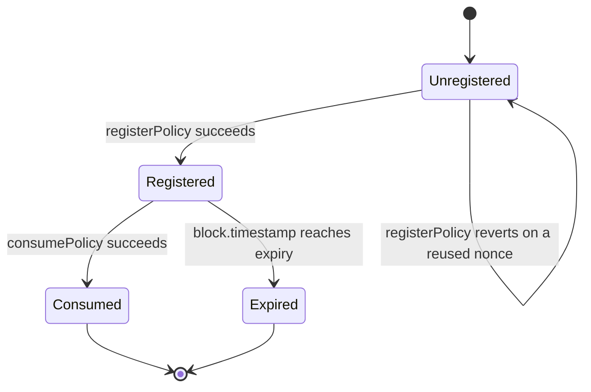
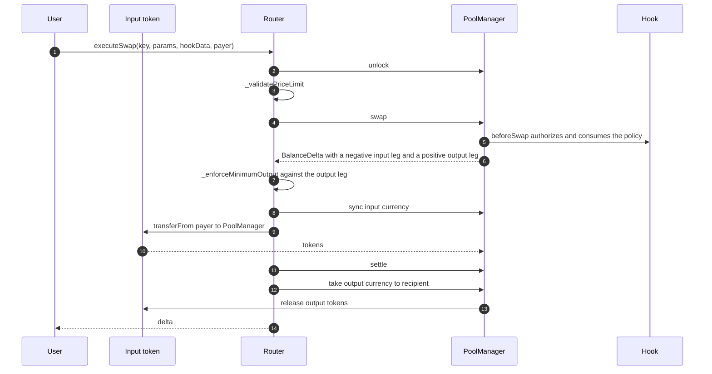

# Data model

This page documents the policy record as it exists in four declarations, how `policyId` is derived, how nonces move through registration and consumption, and how an ERC-20 swap settles. It also records the field drift between the four declarations, because that drift is load-bearing for several security properties.

## The four declarations

The ten-field policy is declared four times in Solidity and once in TypeScript, with three different field sets.

### 1. The signed type, `PolicyVerifier.Policy`

Ten fields. This is the only declaration that determines what the signer commits to, because it is the one hashed under `POLICY_TYPEHASH` ([src/PolicyVerifier.sol:8](../../src/PolicyVerifier.sol#L8) to [src/PolicyVerifier.sol:19](../../src/PolicyVerifier.sol#L19), type hash at [src/PolicyVerifier.sol:21](../../src/PolicyVerifier.sol#L21)).

```
bytes32  poolId
address  trader
uint256  nonce
uint256  expiry
uint256  maxLoss
uint256  maxFee
bool     zeroForOne
int256   amountSpecified
uint160  sqrtPriceLimitX96
uint256  minAmountOut
```

The type string is `Policy(bytes32 poolId,address trader,uint256 nonce,uint256 expiry,uint256 maxLoss,uint256 maxFee,bool zeroForOne,int256 amountSpecified,uint160 sqrtPriceLimitX96,uint256 minAmountOut)`.

### 2. The hook's decode type, `MEVShieldHook.Policy`

Ten fields, same names, same types, hand-copied ([src/MEVShieldHook.sol:40](../../src/MEVShieldHook.sol#L40) to [src/MEVShieldHook.sol:51](../../src/MEVShieldHook.sol#L51)). It exists only so the hook can `abi.decode` the `hookData` tuple. It is converted field-by-field into a `PolicyVerifier.Policy` before being handed to `authorization.authorize` ([src/MEVShieldHook.sol:137](../../src/MEVShieldHook.sol#L137) to [src/MEVShieldHook.sol:150](../../src/MEVShieldHook.sol#L150)).

### 3. The router's decode type, `MEVShieldRouter.Policy`

Ten fields, same shape again ([src/MEVShieldRouter.sol:30](../../src/MEVShieldRouter.sol#L30) to [src/MEVShieldRouter.sol:41](../../src/MEVShieldRouter.sol#L41)). Used only in `_enforceMinimumOutput` to read `minAmountOut` and re-check the parameter binding.

### 4. The stored type, `PolicyRegistry.Policy`

Seven fields. This is the only declaration that determines what persists on-chain ([src/PolicyRegistry.sol:5](../../src/PolicyRegistry.sol#L5) to [src/PolicyRegistry.sol:13](../../src/PolicyRegistry.sol#L13)).

```
bytes32  poolId
address  trader
uint256  nonce
uint256  expiry
uint256  maxLoss
uint256  maxFee
uint256  minAmountOut
```

Three signed fields are absent: `zeroForOne`, `amountSpecified`, `sqrtPriceLimitX96`.

### 5. The off-chain mirror

`backend/src/policy/policy.ts` declares the same ten fields as bigints, booleans and strings ([backend/src/policy/policy.ts:1](../../backend/src/policy/policy.ts#L1)). That is the TypeScript value type, not the signing type.

The EIP-712 field list itself is declared exactly once, in `backend/src/policy/eip712.ts`. That module owns the domain name and version, the ordered `Policy` field list, the type string derived from it, and the resulting type hash ([backend/src/policy/eip712.ts:28](../../backend/src/policy/eip712.ts#L28), [backend/src/policy/eip712.ts:61](../../backend/src/policy/eip712.ts#L61), [backend/src/policy/eip712.ts:66](../../backend/src/policy/eip712.ts#L66)).

Every backend consumer imports from it rather than re-declaring the fields:

| Consumer | Uses |
| --- | --- |
| `backend/src/signer/policySigner.ts` | `policyDomain` and `POLICY_TYPES` ([backend/src/signer/policySigner.ts:17](../../backend/src/signer/policySigner.ts#L17)) |
| `backend/scripts/testSigner.ts` | `policyDomain`, `POLICY_TYPES`, `POLICY_TYPEHASH` |
| `backend/scripts/verifyApiSignature.ts` | `policyDomain`, `POLICY_TYPES` |
| `backend/src/policy/policySigning.test.ts` | `policyDomain`, `POLICY_TYPES` to verify a signature |

`getPolicyTypes()` remains exported from `policySigner.ts` for compatibility but is now deprecated in favour of importing `POLICY_TYPES` directly ([backend/src/signer/policySigner.ts:35](../../backend/src/signer/policySigner.ts#L35)).

### How drift is prevented

Consolidating the off-chain declaration removes duplication between backend modules. It does not, on its own, stop the backend from drifting from Solidity. That is handled by a dedicated test, `backend/src/policy/eip712.test.ts`, which reads `src/PolicyVerifier.sol` as text and parses the `POLICY_TYPEHASH` string literal out of it ([backend/src/policy/eip712.test.ts:26](../../backend/src/policy/eip712.test.ts#L26)). It then asserts three things:

1. The type string derived from the TypeScript field list equals the literal in the Solidity source.
2. `keccak256` of that type string equals the exported `POLICY_TYPEHASH`.
3. The type hash equals a value pinned in the test itself ([backend/src/policy/eip712.test.ts:53](../../backend/src/policy/eip712.test.ts#L53)).

It also asserts the field order and types match the Solidity struct order, and that the domain name and version match the `EIP712("MEVShield", "1")` constructor call ([backend/src/policy/eip712.test.ts:79](../../backend/src/policy/eip712.test.ts#L79)). Because the third check pins a literal, a change to both the parser and the field list cannot mask a real change silently.

The frontend still declares the tuple a further time when it ABI-encodes `hookData` ([frontend/src/hooks/useExecution.ts:196](../../frontend/src/hooks/useExecution.ts#L196)). That declaration is the wire encoding of the struct, not the signing type, and it is not tied to `POLICY_TYPEHASH` by any test. A field added to the Solidity struct would need this tuple updated by hand.

## Field drift

Two different kinds of drift are worth separating.

The first is drift between the off-chain and on-chain declarations of the same signed type. That is now closed for the backend: one module owns the field list, and a test parses the Solidity type hash to prove they agree. See [How drift is prevented](#how-drift-is-prevented).

The second is drift between what is signed and what is stored. The registry keeps seven of the ten signed fields, and that is not cosmetic. Three consequences follow.

### Consequence 1: the registry cannot prove what was authorized

`authorize` compares the signed policy against the stored record field by field ([src/PolicyAuthorization.sol:71](../../src/PolicyAuthorization.sol#L71) to [src/PolicyAuthorization.sol:79](../../src/PolicyAuthorization.sol#L79)). It can only compare the seven fields that exist in storage. Direction, amount and price limit are not compared, because there is nothing to compare them to.

In practice these three values are still bound at execution, twice:

- the hook requires them to equal the live swap params ([src/MEVShieldHook.sol:103](../../src/MEVShieldHook.sol#L103))
- the router requires them to equal the live swap params again ([src/MEVShieldRouter.sol:164](../../src/MEVShieldRouter.sol#L164))

So the signed values cannot be swapped for other values while executing through the protected path. What the drift does prevent is a proof that the policy a signature covered is the policy the registry recorded. A registry reader sees seven fields and cannot tell whether the signed tenth field was the same one the signer intended for a given swap. Storing a hash of the full signed struct would close this, and that is the recommendation recorded in the source review.

### Consequence 2: `policyId` is not a commitment to the policy

See the derivation section below.

### Consequence 3: a policy registered for one swap can be authorized for a different swap shape

Because the registry holds no direction, amount or limit, a single registration is reusable across different swap parameter sets, as long as the nonce is still unconsumed and the signature is re-presented. The signature covers the full ten fields, so the hook will reject a mismatch: `verifyPolicy` recovers the signer from the presented policy, and the presented policy must equal the signed policy for the recovered address to be the authorized signer. A modified direction produces a different digest and a different recovered address, so `UnauthorizedSigner` reverts. The protection therefore holds, but through the signature rather than through storage.

## `policyId` derivation

`policyId = keccak256(abi.encode(poolId, trader, nonce))`

Three derivations must agree, and they do:

| Location | Code |
| --- | --- |
| Registry, on registration | [src/PolicyRegistry.sol:121](../../src/PolicyRegistry.sol#L121) |
| Authorization, on authorize | [src/PolicyAuthorization.sol:66](../../src/PolicyAuthorization.sol#L66) |
| Backend, for correlation | [backend/src/server.ts:276](../../backend/src/server.ts#L276) |
| Monitor, for the hook event | [backend/src/monitor/sepolia.ts:166](../../backend/src/monitor/sepolia.ts#L166) |

Properties of this derivation:

- It is deterministic. `test/PolicyRegistry.t.sol` has a test asserting the same inputs give the same id.
- It is not unique per signature. Two different signed policies with the same `(poolId, trader, nonce)` triple would map to the same id. The registry's `NonceAlreadyRegistered` check prevents a second registration, so in practice one id corresponds to one registration.
- It omits `expiry`, `maxLoss`, `maxFee` and `minAmountOut`. Two policies that differ only in those fields would collide if the registry permitted it. It does not, because the nonce blocks the second registration, but the id is not a content hash and should not be treated as one.
- The backend and the monitor both lowercase the id before using it as a map key ([backend/src/observability/requestCorrelation.ts:31](../../backend/src/observability/requestCorrelation.ts#L31)), which is correct because hashes are case-insensitive hex, and necessary because the JSON representations differ in case between ethers and the registry event.

## Nonce lifecycle

The nonce is the replay guard. There are two independent bitmaps, both keyed by trader and nonce.



| Stage | State change | Guard |
| --- | --- | --- |
| Registration | `registeredNonces[trader][nonce] = true` and the record is written ([src/PolicyRegistry.sol:133](../../src/PolicyRegistry.sol#L133)) | `NonceAlreadyRegistered` ([src/PolicyRegistry.sol:118](../../src/PolicyRegistry.sol#L118)) |
| Authorization | `consumedNonces[trader][nonce] = true` ([src/PolicyRegistry.sol:165](../../src/PolicyRegistry.sol#L165)) | `PolicyAlreadyConsumed` ([src/PolicyRegistry.sol:162](../../src/PolicyRegistry.sol#L162)) and `PolicyExpired` ([src/PolicyRegistry.sol:158](../../src/PolicyRegistry.sol#L158)) |
| Rollback | Both flags revert together with the transaction | EVM revert semantics |

Properties worth stating plainly:

- Consumption is atomic with the swap. `authorize` runs inside `beforeSwap`, inside `PoolManager.swap`, inside the router's unlock. If the swap reverts afterwards for any reason, including a router minimum-output shortfall, the consumption reverts with it. `test/PolicyAuthorization.t.sol` has a test named `test_StateRollsBack_WhenTransactionRevertsAfterAuthorization` and `test/SepoliaForkV2Router.t.sol` has a test asserting the nonce rolls back at the exact minimum-output boundary.
- A policy is single-use. There is no partial consumption and no re-arm.
- An unconsumed policy remains executable until `expiry`. There is no cancel function, so a user who changes their mind cannot invalidate a registered policy. The only remedy is to wait for expiry or to have the owner rotate the registry consumer, which affects all users at once.
- Expired policies cannot be consumed but are not deleted. `getPolicy` keeps returning them, and `isRegistered` keeps returning `true`.
- The nonce is per trader, not global. `test/PolicyRegistry.t.sol` has a test confirming two traders can use the same nonce value.
- The registry enforces only that the nonce has not been used. It does not enforce monotonicity or a window, so a trader may use any nonce value that has not been used before.

The frontend generates the nonce as `Date.now().toString()`, a millisecond timestamp ([frontend/src/hooks/usePolicy.ts:306](../../frontend/src/hooks/usePolicy.ts#L306)). The expiry comes from `buildPolicyExpiry`, a pure function that adds `POLICY_TTL_SECONDS` to the supplied clock reading ([frontend/src/config/policy.ts:32](../../frontend/src/config/policy.ts#L32)); the TTL is 10 minutes ([frontend/src/config/policy.ts:23](../../frontend/src/config/policy.ts#L23)). The backend rejects any expiry more than 30 minutes in the future ([backend/src/policy/policyRequest.ts:64](../../backend/src/policy/policyRequest.ts#L64)) and remains the source of truth for that ceiling. The frontend mirrors the ceiling as `POLICY_MAX_TTL_SECONDS` ([frontend/src/config/policy.ts:10](../../frontend/src/config/policy.ts#L10)) purely so it can assert its own requests stay inside it; raising the mirror changes nothing on the server. A UI request is therefore accepted by the expiry check, and the requested lifetime is deliberately shorter than the ceiling because a policy can be replayed until it expires.

## The ERC-20 settlement path

The protected pool is WETH/USDC on Sepolia. Both legs are ERC-20, even when the UI labels the input as ETH. `SWAP_TOKENS.ETH.address` is the WETH9 address ([frontend/src/config/swapPool.ts:12](../../frontend/src/config/swapPool.ts#L12)), and the display name says the swap executes as WETH ([frontend/src/config/swapPool.ts:28](../../frontend/src/config/swapPool.ts#L28)).

### Sequence



### Amounts and signs

`BalanceDelta` carries two `int128` values. A negative leg means the caller owes the PoolManager; a positive leg means the PoolManager owes the recipient ([src/MEVShieldRouter.sol:198](../../src/MEVShieldRouter.sol#L198)). `_settleAndTake` handles each sign separately ([src/MEVShieldRouter.sol:184](../../src/MEVShieldRouter.sol#L184)).

The output leg chosen by `_enforceMinimumOutput` depends on direction: `delta.amount1()` for `zeroForOne`, `delta.amount0()` otherwise ([src/MEVShieldRouter.sol:171](../../src/MEVShieldRouter.sol#L171)). The value is cast to `uint128` before comparison, and a non-positive output leg is rejected before that cast.

### Approval

The router pulls the input token with `transferFrom`, so the user must approve the router first. The frontend asks for an allowance check, and if the allowance is short it approves exactly the swap amount ([frontend/src/hooks/useExecution.ts:167](../../frontend/src/hooks/useExecution.ts#L167) to [frontend/src/hooks/useExecution.ts#L193](../../frontend/src/hooks/useExecution.ts#L193)). The portfolio page offers the same exact-amount approve plus a revoke-to-zero control ([frontend/src/pages/PortfolioPage.tsx:150](../../frontend/src/pages/PortfolioPage.tsx#L150), [frontend/src/pages/PortfolioPage.tsx:174](../../frontend/src/pages/PortfolioPage.tsx#L174)).

### Native value

The router is payable and does support native currency, but the protected pool is a two-ERC-20 pool, so a protected swap sends no `msg.value`. `_settle` still handles the native branch for other pool keys, and rejects an amount above the call's `nativeBudget` ([src/MEVShieldRouter.sol:220](../../src/MEVShieldRouter.sol#L220)).

### What is not recorded on-chain

The swap leaves no record of the realized output amount. The hook event records `poolId`, `trader`, `nonce`, `maxLoss` and `maxFee`, but not the output ([src/MEVShieldHook.sol:64](../../src/MEVShieldHook.sol#L64)). The registry does not record that a policy was consumed for a particular transaction. The Activity page and the backend monitor therefore reconstruct a swap record from the transaction receipt and the hook event, not from an on-chain output figure. The Activity page shows an em dash in the amount columns for exactly this reason ([frontend/src/hooks/useActivityFeed.ts:78](../../frontend/src/hooks/useActivityFeed.ts#L78)).

## Local storage

The frontend keeps two local, unversioned stores.

| Key | Contents | Written by |
| --- | --- | --- |
| `mevshield-activity-v1` | Up to 200 `ActivityRow` records | [frontend/src/lib/activityStorage.ts:16](../../frontend/src/lib/activityStorage.ts#L16) |
| `mevshield-policy-defaults` | `slippageBps`, `maxLoss`, `maxFee` | [frontend/src/lib/policyDefaults.ts:1](../../frontend/src/lib/policyDefaults.ts#L1) |

Both are read through `try`/`catch` and fall back to a default or empty value on parse failure. Neither is authoritative; they hold display history and UI preferences. The saved `maxLoss` and `maxFee` defaults are labelled as stored locally and are not sent to the backend, since the backend computes both from its own risk model ([frontend/src/pages/PoliciesPage.tsx:107](../../frontend/src/pages/PoliciesPage.tsx#L107)).

## Related pages

- [Contracts](contracts.md) for the per-contract surface.
- [Overview](overview.md) for the enforcement boundary.
- [Backend service](../services/backend.md) for how the backend builds the policy.
