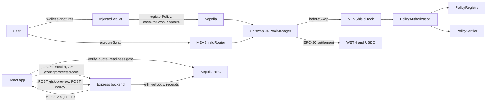
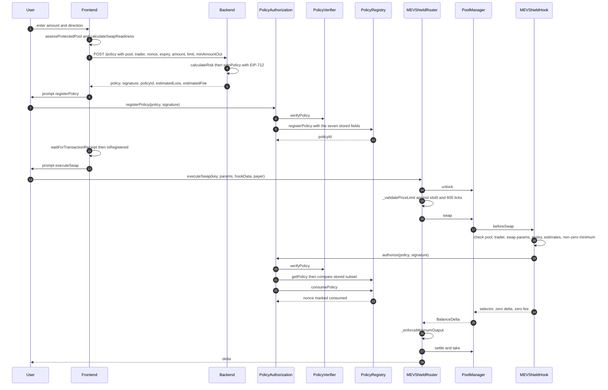

# Architecture overview

This page describes the system as it is implemented at branch HEAD. It does not describe intended future behaviour. Where a constraint is enforced in a place that is weaker than the product framing suggests, that is stated explicitly and the file that performs the check is cited.

Readers who only need the enforcement boundary can skip to [What is enforced on-chain](#what-is-enforced-on-chain).

## System context

MEVShield is three cooperating layers plus the Uniswap v4 infrastructure it runs on.

| Layer | Location | Responsibility |
| --- | --- | --- |
| Contracts | `src/` | Custody-free swap execution, policy registration, policy authorization, and the swap-time policy checks |
| Backend | `backend/src/` | Deterministic risk estimation, EIP-712 policy signing, static policy configuration, log monitoring, structured logging |
| Frontend | `frontend/src/` | Wallet connection, pool and deployment verification, quote readiness gating, policy registration and swap submission |
| Uniswap v4 | `lib/v4-core` (submodule) | PoolManager custody of pool tokens, swap math, hook invocation |

The system is deployed to Sepolia only. Every configuration check in the backend and the frontend asserts an address or chain identifier that matches the current Sepolia deployment, so a local Anvil deployment cannot reuse the Sepolia backend without editing constants.

### Context diagram

The backend never holds user funds and never sends transactions. Its only privileged material is the EIP-712 signing key, which must correspond to the signer address recorded in `PolicyVerifier`.

### Protected swap sequence

The diagram below shows the happy path. The order of operations matters: the hook consumes the policy nonce inside `PoolManager.swap`, and the router's realized-output check runs after the swap returns. If the router check fails, the whole unlock reverts and the nonce consumption is rolled back with it.

## Trust boundaries

There are five boundaries worth naming.

1. Wallet to chain. The user signs `registerPolicy` and `executeSwap`. The router sets `payer` to `msg.sender` ([src/MEVShieldRouter.sol:79](../../src/MEVShieldRouter.sol#L79)) and accepts a separate `recipient` argument that the caller chooses. The policy does not cover payer or recipient.
2. Backend to chain. The backend signs the policy. That signature is the only thing that makes a policy registrable and authorizable. The signing key lives in an in-process wallet built from `SIGNER_PRIVATE_KEY` at startup ([backend/src/config/runtimeConfig.ts:198](../../backend/src/config/runtimeConfig.ts#L198)).
3. Browser to backend. The backend applies no caller authentication. CORS is restricted to one origin ([backend/src/server.ts:86](../../backend/src/server.ts#L86)) but that is a browser control, not a server-side authorization check.
4. Hook to PoolManager. `beforeSwap` is guarded by `onlyPoolManager` ([src/MEVShieldHook.sol:31](../../src/MEVShieldHook.sol#L31)). The hook cannot be called by arbitrary accounts.
5. Router to PoolManager. `unlockCallback` is guarded by an explicit `msg.sender == poolManager` check ([src/MEVShieldRouter.sol:96](../../src/MEVShieldRouter.sol#L96)).

### Roles that can call what

| Contract | Function | Who can call it |
| --- | --- | --- |
| `PolicyRegistry` | `registerPolicy` | `authorizedRegistrar` only ([src/PolicyRegistry.sol:104](../../src/PolicyRegistry.sol#L104)) |
| `PolicyRegistry` | `consumePolicy` | `authorizedConsumer` only ([src/PolicyRegistry.sol:150](../../src/PolicyRegistry.sol#L150)) |
| `PolicyRegistry` | `setAuthorizedConsumer`, `setAuthorizedRegistrar` | `owner` only ([src/PolicyRegistry.sol:75](../../src/PolicyRegistry.sol#L75), [src/PolicyRegistry.sol:87](../../src/PolicyRegistry.sol#L87)) |
| `PolicyVerifier` | `setAuthorizedSigner` | `owner` only ([src/PolicyVerifier.sol:46](../../src/PolicyVerifier.sol#L46)) |
| `PolicyAuthorization` | `setAuthorizedHook` | deployer, once, and only before a hook is set ([src/PolicyAuthorization.sol:30](../../src/PolicyAuthorization.sol#L30)) |
| `PolicyAuthorization` | `registerPolicy` | anyone who holds a valid signature ([src/PolicyAuthorization.sol:37](../../src/PolicyAuthorization.sol#L37)) |
| `PolicyAuthorization` | `authorize` | `authorizedHook` only ([src/PolicyAuthorization.sol:57](../../src/PolicyAuthorization.sol#L57)) |
| `MEVShieldHook` | `beforeSwap` | PoolManager only ([src/MEVShieldHook.sol:81](../../src/MEVShieldHook.sol#L81)) |
| `MEVShieldRouter` | `executeSwap` | anyone; `msg.sender` becomes the payer |

`PolicyAuthorization.registerPolicy` being permissionless is deliberate: the signature proves the policy came from the authorized signer, and the registry nonce table prevents the same signed policy being registered twice.

## What is enforced on-chain

This section is the authoritative statement of the enforcement boundary. Three separate places check policy constraints, and they are not interchangeable.

### `beforeSwap` in the hook

`beforeSwap` performs the following checks, in this order, before the swap executes.

| Check | Failure | Source |
| --- | --- | --- |
| Swap sender is not the zero address | `InvalidTrader` | [src/MEVShieldHook.sol:83](../../src/MEVShieldHook.sol#L83) |
| Derived pool id is not zero | `InvalidPool` | [src/MEVShieldHook.sol:88](../../src/MEVShieldHook.sol#L88) |
| `hookData` decodes to `(Policy, bytes, uint256, uint256)` | ABI decode revert | [src/MEVShieldHook.sol:92](../../src/MEVShieldHook.sol#L92) |
| `policy.poolId` equals the pool key's id | `PoolMismatch` | [src/MEVShieldHook.sol:95](../../src/MEVShieldHook.sol#L95) |
| `policy.trader` equals the swap sender | `TraderMismatch` | [src/MEVShieldHook.sol:99](../../src/MEVShieldHook.sol#L99) |
| `zeroForOne`, `amountSpecified` and `sqrtPriceLimitX96` equal the swap params | `SwapMismatch` | [src/MEVShieldHook.sol:103](../../src/MEVShieldHook.sol#L103) |
| `block.timestamp < policy.expiry` | `PolicyExpired` | [src/MEVShieldHook.sol:110](../../src/MEVShieldHook.sol#L110) |
| `estimatedLoss <= policy.maxLoss` | `MaxLossExceeded` | [src/MEVShieldHook.sol:114](../../src/MEVShieldHook.sol#L114) |
| `estimatedFee <= policy.maxFee` | `MaxFeeExceeded` | [src/MEVShieldHook.sol:118](../../src/MEVShieldHook.sol#L118) |
| `policy.minAmountOut != 0` | `InvalidMinimumOutput` | [src/MEVShieldHook.sol:121](../../src/MEVShieldHook.sol#L121) |
| Valid EIP-712 signature, registered policy match, nonce unconsumed | `UnauthorizedSigner`, `PolicyMismatch`, `PolicyAlreadyConsumed` and others from the authorization chain | [src/MEVShieldHook.sol:136](../../src/MEVShieldHook.sol#L136) |

So `beforeSwap` enforces the signature, the expiry, the nonce, the pool binding, the swap-parameter binding, and a non-zero `minAmountOut`. It does not measure realized output, realized loss, or realized fees.

### `executeSwap` in the router

The router enforces two things the hook does not.

1. Realized minimum output. `_enforceMinimumOutput` re-decodes the policy from `hookData`, re-checks that the policy's pool id, direction, amount and price limit match the call, and then compares the swap delta's output leg against `policy.minAmountOut` ([src/MEVShieldRouter.sol:154](../../src/MEVShieldRouter.sol#L154)). A shortfall reverts with `MinimumOutputNotMet`.
2. The 600-tick cap. `_validatePriceLimit` reads `slot0` from the PoolManager, rejects a limit on the wrong side of the current price, and rejects a limit more than `MAX_PRICE_LIMIT_TICK_DISTANCE` ticks away ([src/MEVShieldRouter.sol:125](../../src/MEVShieldRouter.sol#L125), constant declared at [src/MEVShieldRouter.sol:60](../../src/MEVShieldRouter.sol#L60)).

Both checks live in the router, not the hook. The hook address is mined so that only the `beforeSwap` permission bit is set ([script/DeploySepolia.s.sol:131](../../script/DeploySepolia.s.sol#L131)), so `afterSwap` is never invoked. A caller that bypasses the router and calls `PoolManager.swap` directly, with a valid signed policy in `hookData`, passes the hook and skips both router checks. This is why the router checks must be read as checks for this router, not as protocol-wide guarantees.

### What `maxLoss` and `maxFee` actually compare

The hook compares `policy.maxLoss` and `policy.maxFee` against `estimatedLoss` and `estimatedFee` that are decoded from `hookData` ([src/MEVShieldHook.sol:92](../../src/MEVShieldHook.sol#L92), compared at [src/MEVShieldHook.sol:114](../../src/MEVShieldHook.sol#L114) and [src/MEVShieldHook.sol:118](../../src/MEVShieldHook.sol#L118)). Those two integers are not part of `POLICY_TYPEHASH` ([src/PolicyVerifier.sol:21](../../src/PolicyVerifier.sol#L21)) and are not stored in the registry. A caller can supply zeros and satisfy both comparisons.

The caps are therefore a bound on a caller-supplied estimate, not a measurement of realized loss or realized fees. The contract header says so directly ([src/MEVShieldHook.sol:23](../../src/MEVShieldHook.sol#L23)), and `test/MEVShieldHook.t.sol` contains a test named `test_ThreatModel_ActualLossAndFeeAreCallerSupplied` that asserts this behaviour.

### Enforcement summary

| Constraint | Signed | Stored in registry | Hook | Router | Enforced against |
| --- | --- | --- | --- | --- | --- |
| Pool id | Yes | Yes | Yes | Yes | Pool key |
| Direction, amount, price limit | Yes | No | Yes | Yes | Swap params |
| Trader equals swap sender | Yes | Yes | Yes | Yes, on the minimum-output path | `sender` from PoolManager |
| Expiry | Yes | Yes | Yes | No | `block.timestamp` |
| Nonce replay | Yes | Yes, registered and consumed | Via authorization | No | Registry state |
| `minAmountOut` non-zero | Yes | Yes | Yes | Yes | Value |
| `minAmountOut` realized | Yes | Yes | No | Yes | Swap delta |
| 600-tick distance | No | No | No | Yes | `slot0` at execution |
| `maxLoss`, `maxFee` | Cap signed, estimate not | Yes | Compares to caller estimate | No | Caller-supplied integers |
| Payer and recipient | No | No | No | `msg.sender` and an argument | Nothing |

## What is enforced off-chain

Off-chain code produces and grades inputs. It cannot prevent a transaction that has a valid signature from executing.

- Risk estimation runs in the backend as a closed-form function ([backend/src/risk/riskEngine.ts:12](../../backend/src/risk/riskEngine.ts#L12)). Every non-zero amount produces `estimatedLoss = amount / 1000` and `estimatedFee = amount / 10000`, and `maxLoss` and `maxFee` are twice those values. `riskLevel` is always `LOW`. The response carries a disclaimer stating the figures are not a live measurement ([backend/src/risk/riskPreview.ts:6](../../backend/src/risk/riskPreview.ts#L6)).
- Policy signing runs in the backend and refuses a pool id that is not the pinned protected pool ([backend/src/policy/policySigning.ts:24](../../backend/src/policy/policySigning.ts#L24)).
- Readiness gating runs in the frontend and decides whether the UI will offer the sign and execute steps ([frontend/src/lib/protectedQuote.ts:310](../../frontend/src/lib/protectedQuote.ts#L310)).
- Configuration pinning runs in the backend at startup and refuses to start on a chain, verifier, router or pool that does not match the pinned Sepolia deployment ([backend/src/config/runtimeConfig.ts:158](../../backend/src/config/runtimeConfig.ts#L158)).

The frontend gates are advisory in the strict sense: they stop this UI from submitting, and nothing else. A user with a valid signed policy can bypass the UI entirely.

## Deployment topology

The deployed Sepolia addresses are recorded twice, once in the frontend and once in the backend, and both are compared against on-chain reads at runtime.

| Contract | Address | Source of truth in the repository |
| --- | --- | --- |
| PoolManager | `0xE03A1074c86CFeDd5C142C4F04F1a1536e203543` | [frontend/src/lib/contracts.ts:20](../../frontend/src/lib/contracts.ts#L20) |
| PolicyRegistry | `0xB2897da1CfC0c73C3983221a87C27586D1cE1c9E` | [frontend/src/lib/contracts.ts:23](../../frontend/src/lib/contracts.ts#L23) |
| PolicyVerifier | `0x716f9315BC9c2AB98a82DDE78ca86887Ab61b79f` | [backend/src/config/runtimeConfig.ts:12](../../backend/src/config/runtimeConfig.ts#L12) |
| PolicyAuthorization | `0xefC9bc21f1ab3564232a3216f0e45d5caE3Bd7c5` | [frontend/src/lib/contracts.ts:28](../../frontend/src/lib/contracts.ts#L28) |
| MEVShieldHook | `0xd15e4fdd391a68c2f1c385d1a819117a3ad40080` | [frontend/src/lib/contracts.ts:34](../../frontend/src/lib/contracts.ts#L34) |
| MEVShieldRouter | `0x633282608B2fc66cD7572f5eF58e804063aa150D` | [backend/src/config/runtimeConfig.ts:20](../../backend/src/config/runtimeConfig.ts#L20) |
| Authorized signer | `0x016B78a30CE176EF0B90c122e8677e13aAB2A815` | [backend/src/config/runtimeConfig.ts:10](../../backend/src/config/runtimeConfig.ts#L10) |
| Protected pool id | `0x9275e922143fd87aa42dea59b14fedae2df09098cf62ef0fc60a3799f903b602` | [backend/src/config/runtimeConfig.ts:23](../../backend/src/config/runtimeConfig.ts#L23) |

The router exposes only `poolManager()` as an immutable getter. It has no `protectedPoolId()` or `protectedHook()` function, and never did in any committed revision. Any component that needs the protected pool id or hook address reads it from configuration. See [ADR 0003](../decisions/0003-config-sourced-pool-identity.md).

## Related pages

- [Contracts](contracts.md) for the per-contract surface.
- [Data model](data-model.md) for the struct drift and nonce lifecycle.
- [Backend service](../services/backend.md) and [frontend service](../services/frontend.md).
- [API reference](../api/reference.md) and [configuration](../operations/configuration.md).
