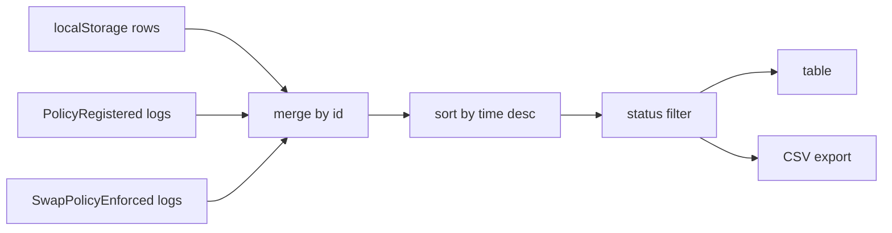

# Activity history

**Status: partial.** Local history is complete. On-chain history is a bounded log scan with incomplete field coverage, and it cannot show amounts.

The Activity page merges locally stored rows with on-chain events for the connected wallet.

## What it does

`useActivityFeed` performs two reads over a 50,000-block lookback from the current head ([frontend/src/hooks/useActivityFeed.ts:17](../../frontend/src/hooks/useActivityFeed.ts#L17)):

- `PolicyRegistered` logs from the registry
- `SwapPolicyEnforced` logs from the hook

Each log's transaction is fetched to read its sender, and rows are kept only when the sender matches the connected account ([frontend/src/hooks/useActivityFeed.ts:74](../../frontend/src/hooks/useActivityFeed.ts#L74)). For a registration that filter is right, because the user submits `registerPolicy` themselves. For a swap it is also right, because the user calls `executeSwap` on the router directly.

Rows are merged with `localStorage` rows, de-duplicated by id, and sorted descending by the local `time` field.

## Row sources

| Row type | Id | Fields available |
| --- | --- | --- |
| Local registration | `<txHash>-reg` | pair, amount in, minimum output, status `registered`, tx hash, policy id |
| Local execution | `<txHash>-exec` | pair, amount in, minimum output, status `executed`, tx hash, policy id |
| Chain registration | `<txHash>-reg` | pair fixed to `WETH / USDC`, minimum output from the event, status `registered`, no amount in |
| Chain enforcement | `<txHash>-enf` | pair fixed to `WETH / USDC`, no amounts, status `enforced` |

Chain rows carry no amount in and no amount out, because neither event includes them. The table shows an em dash for those cells. Local rows fill the amount in, which is why the local store matters for a usable history.

## What it depends on

| Dependency | Why |
| --- | --- |
| A connected wallet | The page shows a connect prompt without one, and filtering needs an account |
| Public RPC reachable | All on-chain reads go through the hard-coded public endpoint |
| One `getTransaction` per log | Needed to identify the sender |
| `localStorage` | Local rows |

## CSV export

`activityToCsv` writes a header and one quoted row per visible row ([frontend/src/lib/activityStorage.ts:23](../../frontend/src/lib/activityStorage.ts#L23)). Columns: time, pair, amountIn, amountOut, minAmountOut, status, txHash, policyId. The export respects the current status filter, so exporting while filtered produces a partial file.

## Known limitations

- **Time is wrong for chain rows.** `time` is set to `Date.now()` at refresh time, not the block timestamp ([frontend/src/hooks/useActivityFeed.ts:61](../../frontend/src/hooks/useActivityFeed.ts#L61)). Every chain row from one refresh carries the same timestamp, so ordering within a refresh is arbitrary and the displayed date is the date of the last page load.
- **50,000-block window.** Anything older than roughly a week on Sepolia is invisible. There is no pagination and no cursor.
- **One RPC call per log.** A wallet with many events will issue hundreds of `getTransaction` calls per refresh, serially in the loop. That is slow and will likely be rate limited by the public endpoint.
- **Reverted transactions do not appear.** Reverted calls emit no logs, so a failed swap leaves no chain row. The local store only records successes too, since it is written after a receipt with status `success`. The `failed` and `reverted` filter options are therefore unreachable in normal use.
- **Consumption is not a row type.** There is no `PolicyConsumed` event. An `enforced` row is the only on-chain evidence a policy was used.
- **Pair is hard-coded.** Chain rows always say `WETH / USDC`, even if a future deployment protects a different pair.
- **Local rows are capped at 200** and are per browser, not per wallet. `appendActivity` keeps the newest 200 rows by id and never records an owner, so switching wallets in the same browser shows the previous wallet's local rows ([frontend/src/lib/activityStorage.ts:16](../../frontend/src/lib/activityStorage.ts#L16)).
- **No error surface.** A failed refresh logs to the console and falls back to local rows only ([frontend/src/hooks/useActivityFeed.ts:96](../../frontend/src/hooks/useActivityFeed.ts#L96)). The page shows no indication that the chain portion failed.

## Related pages

- [Frontend service](../services/frontend.md).
- [Data model](../architecture/data-model.md).
- [Monitoring](../services/monitoring.md) for the backend's independent view of the same events.
