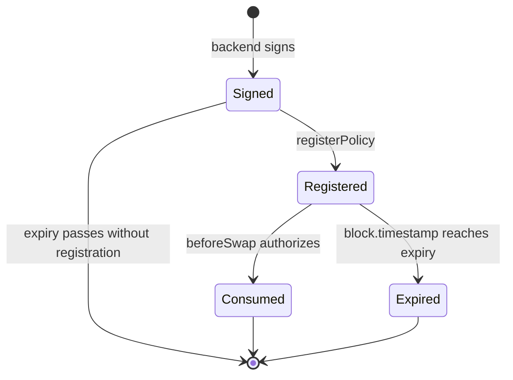

# Policy lifecycle

**Status: partial.** Registration, authorization and consumption are implemented and tested. Cancellation, a full-policy commitment, and caller authentication on signing are not built.

A policy is the unit of authorization in MEVShield. It is created off-chain by the backend, registered on-chain by the user, consumed once at swap time, and never reusable.

## What it does

The lifecycle has five states and three transitions.

| Transition | Actor | Contract call | State change |
| --- | --- | --- | --- |
| Sign | Backend signer | none | None on-chain. The signature exists only in the HTTP response and the browser |
| Register | User wallet | `PolicyAuthorization.registerPolicy(policy, signature)` | Registry writes the seven-field record and sets `registeredNonces[trader][nonce]` |
| Authorize and consume | PoolManager, via the hook | `PolicyAuthorization.authorize(policy, signature)` | Registry sets `consumedNonces[trader][nonce]` |

There is no on-chain record of the signed-but-unregistered state. A signature that is never registered leaves no trace on chain and simply expires unused.

## Registration

`PolicyAuthorization.registerPolicy` is permissionless and takes the ten-field policy plus the signature ([src/PolicyAuthorization.sol:37](../../src/PolicyAuthorization.sol#L37)).

1. `verifier.verifyPolicy(policy, signature)` reverts unless the signature recovers to `authorizedSigner`.
2. `registry.registerPolicy` is called with seven fields: `poolId`, `trader`, `nonce`, `expiry`, `maxLoss`, `maxFee`, `minAmountOut`.
3. The registry rejects a zero pool id, a zero trader, an expiry at or before the current time, and a reused `(trader, nonce)` pair.
4. The registry computes `policyId = keccak256(abi.encode(poolId, trader, nonce))`, stores the record, sets the registration flag, and emits `PolicyRegistered`.

The frontend performs this call with the ten fields and the signature it received ([frontend/src/hooks/usePolicy.ts:372](../../frontend/src/hooks/usePolicy.ts#L372)), then waits for the receipt and confirms with `isRegistered` before treating the policy as live ([frontend/src/hooks/usePolicy.ts:422](../../frontend/src/hooks/usePolicy.ts#L422)).

Because registration is permissionless, a third party may register a signature they obtained. That is not a vulnerability: the registry records exactly the signed policy, and the only actor who can use it is one who can present a matching policy at swap time, which requires the same signature. The registration only costs gas.

A front-runner who copies an unregistered signature and registers it first changes nothing about the policy contents. A front-runner who wants to register a *different* policy under the same nonce would need a signature over that different policy, because step 1 rejects anything else.

## Authorization and consumption

`PolicyAuthorization.authorize` runs inside `beforeSwap`, so it runs inside `PoolManager.swap`, inside the router's unlock.

1. Caller must be `authorizedHook`.
2. `verifier.verifyPolicy`.
3. `policyId` derived from the presented policy.
4. `registry.getPolicy(policyId)` and a field-by-field comparison of the seven stored fields against the presented values. Divergence reverts `PolicyMismatch`.
5. `registry.consumePolicy(policyId)`, which re-checks existence, expiry and prior consumption, then sets the consumed flag.

Step 5 is last on purpose. If any earlier step reverts, no state change occurs. If the swap reverts after `authorize` returns, the EVM rolls back the consumption together with everything else. `test/PolicyAuthorization.t.sol` asserts this with a dedicated rollback test, and `test/SepoliaForkV2Router.t.sol` asserts that the nonce rolls back at the exact minimum-output boundary.

## Inspection

Three read paths exist.

| Read | Contract | Returns |
| --- | --- | --- |
| `getPolicy(policyId)` | Registry | The seven-field record, or a zero struct when absent |
| `isRegistered(trader, nonce)` | Registry | Whether the pair was registered |
| `isConsumed(trader, nonce)` | Registry | Whether the pair was consumed |

The Policies page accepts a policy id and reports status, trader, nonce, minimum output, max loss and max fee ([frontend/src/pages/PoliciesPage.tsx:20](../../frontend/src/pages/PoliciesPage.tsx#L20)). Status is derived: consumed if `isConsumed`, else expired if `expiry` is in the past, else active. The page formats the minimum output in USDC decimals regardless of direction ([frontend/src/pages/PoliciesPage.tsx:37](../../frontend/src/pages/PoliciesPage.tsx#L37)), so a WETH-direction minimum is displayed at the wrong scale.

## Events

| Event | Emitted by | Carries |
| --- | --- | --- |
| `PolicyRegistered` | Registry | policy id, pool id, trader, nonce, expiry, max loss, max fee, min amount out |
| `SwapPolicyEnforced` | Hook | pool id, trader, nonce, max loss, max fee |
| `AuthorizedConsumerUpdated` | Registry | old and new consumer |
| `AuthorizedRegistrarUpdated` | Registry | old and new registrar |
| `AuthorizedSignerUpdated` | Verifier | old and new signer |

There is no event for consumption. A consumer must read `isConsumed` to learn whether a policy was used, or infer it from a `SwapPolicyEnforced` log with a matching `(poolId, trader, nonce)`.

## What it depends on

| Dependency | Why |
| --- | --- |
| Backend `POST /policy` with signing enabled | A signature cannot be obtained otherwise |
| The verifier's `authorizedSigner` matching the backend key | `verifyPolicy` recovers to this address |
| The registry's `authorizedRegistrar` set to the authorization contract | Else registration reverts `Unauthorized` |
| The registry's `authorizedConsumer` set to the authorization contract | Else consumption reverts `Unauthorized`, and the frontend blocks |
| The authorization contract's `authorizedHook` set to the hook | Else `authorize` reverts `Unauthorized` |
| Wallet funds for the registration gas | The user pays |

## Known limitations

- **No cancellation.** A registered policy is executable until consumed or expired. There is no on-chain cancel and no signed revocation. `docs/reviews/2026-10-28-code-review.md` records this as an open finding.
- **No full-policy commitment.** The registry stores seven of ten signed fields. `PolicyAuthorization.authorize` can only compare what is stored. The three omitted fields are still bound at execution by the hook and router, but a registry reader cannot verify that the stored record corresponds to the full signed intent.
- **The consumer can be retargeted.** `setAuthorizedConsumer` is an owner call with no delay and no two-step handover, so the owner can point consumption at a different contract at any time, affecting every unexpired policy at once.
- **The signer can be retargeted.** `setAuthorizedSigner` is also a single owner call. Rotating it invalidates every outstanding signed policy, including registered ones, because `authorize` re-verifies the signature.
- **No caller authentication on signing.** Any client that reaches the backend can request a signature when signing is enabled. See [API reference](../api/reference.md#post-policy).
- **No rate limit.** A caller may request signatures without bound.
- **The signed trader is the router, not the user.** `trader` must equal the configured router ([backend/src/server.ts:212](../../backend/src/server.ts#L212)), and the hook requires `policy.trader == sender` where `sender` is the router. So every policy names the same trader. Per-user identity is not in the policy at all.
- **Local defaults are not used.** The Policies page stores max loss and max fee in `localStorage`, but those values are never sent to the backend; the backend computes them from its own formula ([frontend/src/pages/PoliciesPage.tsx:107](../../frontend/src/pages/PoliciesPage.tsx#L107)).
- **The UI expiry exceeds the backend ceiling.** See [data model](../architecture/data-model.md#nonce-lifecycle).
- **No pagination or index of policies.** Policies are found by id or by scanning `PolicyRegistered` logs.

## Related pages

- [Data model](../architecture/data-model.md).
- [Contracts](../architecture/contracts.md).
- [ADR 0001](../decisions/0001-signed-policy-authorization.md).
- [ADR 0005](../decisions/0005-execute-gate-stays-closed.md).
