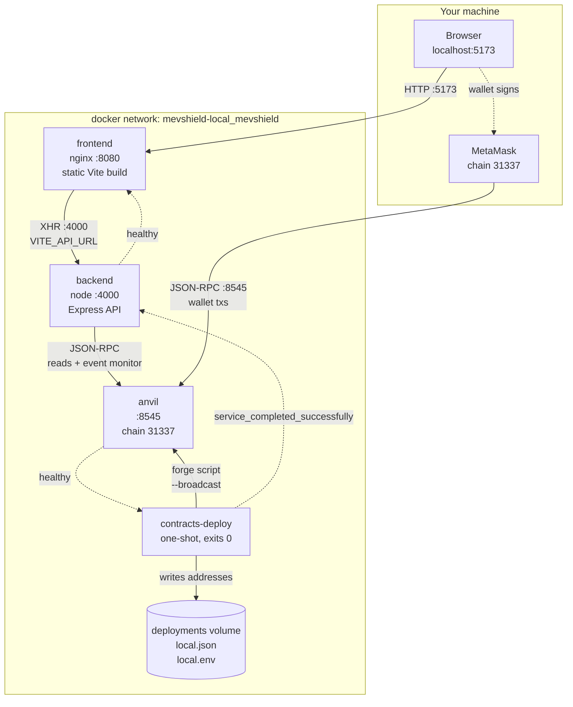

# Running MEVShield locally with Docker

One command brings up a complete local copy of the project: a chain, the
contracts deployed to it, the backend and the frontend.

```bash
./script/docker-local-up.sh
```

Then open <http://localhost:5173>.

Everything in this stack is local only. The chain is anvil (chain id 31337), the
keys are anvil's published development keys, and none of it is connected to
Sepolia or any real network. The contract deploy script refuses to run against
anything but chain 31337.

---

## 1. Prerequisites

| Requirement | Why |
| --- | --- |
| Docker Desktop (or Docker Engine + Compose v2) | Runs everything. Verified with Docker 28.5.1 and Compose 2.40.3 |
| ~4 GB free disk | The contracts toolchain image is 712 MB, the backend 270 MB, the frontend 83 MB |
| Git | The contracts image copies `lib/` from your checkout, so the submodules must be present |
| Network access on first build | To pull base images and let `forge` fetch solc 0.8.26 |

Node and Foundry are **not** required on the host. The only exception is
`./script/docker-local-verify.sh`, which uses `node` plus `backend/node_modules`
for its final on-chain signature check; without them it skips that one assertion
and still runs the other ten.

The up script initialises the submodules for you if they are missing:

```
lib/forge-std
lib/openzeppelin-contracts
lib/v4-core
lib/v4-core/lib/solmate        <- nested; SetupBackendSwap imports it
```

If you prefer to do it yourself, run `git submodule update --init --recursive`.
A fresh clone without submodules can still build the contracts image by passing
`SUBMODULE_MODE=fetch`, which clones them during the build instead.

---

## 2. One-command start

```bash
# start (builds if needed, waits for health, prints the addresses)
./script/docker-local-up.sh

# start from a clean chain, discarding all previous state
./script/docker-local-up.sh --reset

# start and then follow the logs
./script/docker-local-up.sh --logs

# stop and remove the volumes
./script/docker-local-up.sh --down
```

Plain Compose works too, if you would rather see the raw output:

```bash
docker compose build
docker compose up -d
```

`docker compose up -d` returns as soon as containers are created. Use
`docker compose up -d --wait` to block until every healthcheck passes, or
`docker compose ps` to watch.

### What the script verifies before it reports success

It does not print "up" until each layer answers:

```
    anvil        eth_chainId 0x7a69 (31337)
    contracts    docker-deploy-local.sh exited 0
    backend      /health 200 status=ok
    frontend     / and /network both 200
```

If any of those fails, the script exits non-zero naming the failed layer and
prints the tail of the deploy log.

---

## 3. Service topology



`anvil` is the only service with no dependency. `contracts-deploy` waits for
anvil to be healthy, deploys, and exits 0. `backend` starts only once that exit
is 0, and `frontend` starts only once the backend is healthy. A failed deploy
therefore stops the chain of starts instead of leaving a half-wired stack.

---

## 4. Ports

| Service | Container port | Host port | Override |
| --- | --- | --- | --- |
| frontend | 8080 | **5173** | `FRONTEND_PORT` |
| backend | 4000 | **4000** | `BACKEND_PORT` |
| anvil | 8545 | **8545** | `ANVIL_PORT` |

The frontend listens on 8080 inside the container so nginx can run as the
unprivileged `nginx` user; ports below 1024 need root. The host port is 5173 to
match the Vite dev server and the backend's default CORS origin.

If a host port is taken, change it in `docker/.env.docker` and change the
matching URL too:

```bash
BACKEND_PORT=4100
VITE_API_URL=http://localhost:4100    # the browser must reach this
ANVIL_PORT=8645
VITE_RPC_URL=http://localhost:8645    # the browser must reach this
FRONTEND_PORT=5273
FRONTEND_URL=http://localhost:5273    # CORS allowlist
```

`VITE_API_URL` and `VITE_RPC_URL` are compiled into the JavaScript, so after
changing either one rebuild the frontend image:
`docker compose build frontend`.

---

## 5. Deployed addresses

These are deterministic. `DeployLocal.s.sol` deploys from a fixed account with a
fixed nonce sequence, and the hook address is CREATE2-mined, so a fresh anvil
always produces the same set. That is what lets the backend and frontend pin
them in `docker-compose.yml` before the deploy has run.

| Contract | Address |
| --- | --- |
| PoolManager | `0x5FbDB2315678afecb367f032d93F642f64180aa3` |
| PolicyRegistry | `0xe7f1725E7734CE288F8367e1Bb143E90bb3F0512` |
| PolicyVerifier | `0x9fE46736679d2D9a65F0992F2272dE9f3c7fa6e0` |
| PolicyAuthorization | `0xCf7Ed3AccA5a467e9e704C703E8D87F634fB0Fc9` |
| MEVShieldHook | `0x1e2F391574556815aE705895F2728543A7AD4080` |
| MEVShieldRouter | `0x8A791620dd6260079BF849Dc5567aDC3F2FdC318` |
| AuthorizedSigner | `0xe05fcC23807536bEe418f142D19fa0d21BB0cfF7` |

`SetupBackendSwap.s.sol` then deploys two 18-decimal `MockERC20` tokens and the
pool:

| Item | Value |
| --- | --- |
| Token A (currency0) | `0x610178dA211FEF7D417bC0e6FeD39F05609AD788` |
| Token B (currency1) | `0xB7f8BC63BbcaD18155201308C8f3540b07F84F5e` |
| Fee / tick spacing | 3000 / 60 |
| Pool id | `0x8d754c8c3f0e991efb877b18bf00b8d0718c2cd8af8f31a35c61de1415e19bf0` |

Read them from the running stack at any time:

```bash
docker compose exec contracts-deploy cat /deployments/local.json
```

The deploy script verifies the addresses it produced match the ones the other
services expect, and exits non-zero if they do not.

---

## 6. Reset, stop, and clean up

| Goal | Command |
| --- | --- |
| Restart services, keep chain state | `docker compose restart` |
| Rebuild after a code change | `docker compose build && docker compose up -d` |
| Start over from a clean chain | `./script/docker-local-up.sh --reset` |
| Stop everything, keep the addresses volume | `docker compose down` |
| Stop and delete all volumes | `docker compose down -v` |

anvil has **no** state volume on purpose. It keeps chain state in memory, so
every `docker compose up` after a `down` starts from the same genesis block with
the same addresses. This is what makes re-running the stack reliable. If it
persisted state, the second deploy would land on later nonces, produce different
addresses, and trip the drift guard.

Re-running `up` against a stack that is already running is safe: the deploy
script notices the recorded router still has code and skips. To force a real
redeploy onto the same chain, set `FORCE_REDEPLOY=1`.

---

## 7. Reading logs

```bash
docker compose logs -f                     # everything
docker compose logs -f backend             # backend request and policy logs
docker compose logs -f anvil               # RPC calls and mined blocks
docker compose logs -f frontend            # nginx access log; open the page to see hits
docker compose logs contracts-deploy       # the full deploy transcript
docker compose logs --no-log-prefix --tail 50 contracts-deploy
```

The backend logs one JSON line per request with a `requestId`, plus policy
lifecycle events (`risk_analysis_started`, `policy_signed`) and the event monitor
(`sepolia_new_block`, `sepolia_contract_event`). The monitor's event names keep
the `sepolia_` prefix even on the local chain; that naming is unchanged on
purpose so existing dashboards and greps keep working.

---

## 8. Verifying each layer is healthy

`./script/docker-local-verify.sh` runs all of this and exits non-zero on any
failure. By hand:

### Layer 1 — anvil

```bash
curl -s -X POST -H 'content-type: application/json' \
  --data '{"jsonrpc":"2.0","id":1,"method":"eth_chainId","params":[]}' \
  http://localhost:8545
# {"jsonrpc":"2.0","id":1,"result":"0x7a69"}     0x7a69 = 31337
```

### Layer 2 — contracts

```bash
docker inspect mevshield-contracts-deploy --format '{{.State.ExitCode}}'
# 0

docker compose logs --no-log-prefix contracts-deploy | tail -5
# [deploy] pool initialized, sqrtPriceX96=79228162514264337593543950336
# [deploy] pool funded, token0=5981737760509663 token1=5981737760509663
# [deploy] deployment matches the expected local addresses
```

The deploy prints `pool initialized` and `pool funded` only after reading those
values back from the chain, so those two lines are a real assertion, not an echo
of intent.

### Layer 3 — backend

```bash
curl -s localhost:4000/health
# {"status":"ok","service":"mevshield-backend","environment":"development",
#  "chainId":31337,"policySigningEnabled":true,"localDemoMode":false,
#  "sepoliaMonitor":{"status":"connected","lastCheckedBlock":21}}
```

`chainId:31337` confirms the backend accepted the local chain.
`sepoliaMonitor.status:"connected"` confirms it is following anvil blocks.

```bash
curl -s localhost:4000/config/protected-pool   # the deployed pool id
```

### Layer 4 — frontend

```bash
curl -s -o /dev/null -w '%{http_code} %{content_type}\n' localhost:5173/
# 200 text/html

curl -s localhost:5173/ | grep -o '<title>.*</title>'
# <title>MEVShield</title>

curl -s -o /dev/null -w '%{http_code}\n' localhost:5173/network
# 200    <- SPA fallback: a deep route returns index.html, not a 404
```

To confirm the bundle points at the local chain rather than Sepolia:

```bash
JS=$(curl -s localhost:5173/ | grep -o '/assets/index-[^"]*\.js' | head -1)
curl -s "localhost:5173$JS" | grep -c 'Anvil Local'          # 1
curl -s "localhost:5173$JS" | grep -c 'localhost:8545'       # 1
```

### The end-to-end proof

The check that actually proves the signing path is wired up takes the signature
the backend produced and asks the **deployed** verifier to accept it:

```bash
./script/docker-local-verify.sh
```

```
MEVShield local stack verification

  PASS  anvil eth_chainId is 0x7a69 (31337)
  PASS  contracts-deploy exited 0
  PASS  MEVShieldRouter has deployed code
  PASS  protected pool is initialized (slot0 sqrtPriceX96 non-zero)
  PASS  backend /health 200 with chainId 31337
  PASS  backend serves the deployed protected pool id
  PASS  frontend serves the app (200)
  PASS  frontend HTML is the MEVShield app
  PASS  SPA fallback serves a deep route (/network)
  PASS  backend signed a policy
  PASS  deployed PolicyVerifier accepts the backend signature

  11 passed, 0 failed
```

The last line is the important one. It calls
`PolicyVerifier.verifyPolicy(policy, signature)` on chain with the backend's
signature. If the EIP-712 domain (`MEVShield` / `1`), the chain id, the verifying
contract address, or the signer key were wrong, that call reverts instead of
returning `true`.

### How the verify script finds the stack

The script reads the same port variables the stack was started with, in the same
precedence order `script/docker-local-up.sh` uses:

| Source | Wins over |
| --- | --- |
| An environment variable set in your shell | everything |
| `docker/.env.docker` | the built-in defaults |
| Built-in defaults (8545 / 4000 / 5173) | nothing |

This is the reverse of what an earlier revision did: it had a hard-coded default
of 8545 / 4000 / 5173 regardless of the file, so a stack moved to other ports
produced ten `fetch failed` lines instead of a pass.

So if you moved the stack to other ports in `docker/.env.docker`, verify with no
arguments at all — no environment variables are needed:

```bash
./script/docker-local-verify.sh
#   anvil http://127.0.0.1:8645   backend http://localhost:4100   frontend http://localhost:5273
#   ports from docker/.env.docker
```

To check a stack on a different port for one run, without editing the file, pass
the variable explicitly. An explicit value always overrides the file:

```bash
ANVIL_PORT=8645 BACKEND_PORT=4100 FRONTEND_PORT=5273 ./script/docker-local-verify.sh
```

The script prints the three URLs it will use before it starts, so a mismatch is
visible immediately. Each `FAIL` also prints the exact URL it tried.

If anvil does not answer at all, the script stops before the individual checks
and says so, rather than printing a failure for every layer:

```
  FAIL  nothing is answering JSON-RPC at http://127.0.0.1:8545

  The stack is probably not running, or it is on different ports than this
  script expects. Ports came from: no env file; compose defaults

  Fix one of these:
    start the stack        ./script/docker-local-up.sh
    use the running ports  ANVIL_PORT=<port> BACKEND_PORT=<port> FRONTEND_PORT=<port> ./script/docker-local-verify.sh
    record them in the file docker/.env.docker, which compose and this script both read
```

The script never prints the contents of `docker/.env.docker`, so the development
keys it may contain are not echoed. Only the three port values are read out of it.

---

## 9. Using the app in a browser

1. Open <http://localhost:5173>.
2. Add the network to MetaMask:

   | Field | Value |
   | --- | --- |
   | Network name | MEVShield Local |
   | RPC URL | `http://localhost:8545` |
   | Chain ID | 31337 |
   | Currency symbol | ETH |

3. Import an anvil account. Account #0's key is in
   `docker/.env.docker.example`. **These keys are published in every anvil
   install. They are insecure and hold no value.**

The UI labels the network "Anvil Local · 31337" and the token pair as local test
tokens, so a screenshot cannot be mistaken for the Sepolia deployment.

---

## 10. What is wired and what is not

Wired and working locally:

- Contracts deployed to anvil, hook permissions validated, pool initialized with
  liquidity.
- Backend serving `/health`, `/config/protected-pool`, `/risk-preview` and
  `/policy`, signing EIP-712 policies with the on-chain authorized signer.
- Backend event monitor following anvil, decoding policy and swap events.
- Frontend reading chain 31337, showing real balances for the mock tokens, and
  serving every route.
- Policy registration through the UI: the wallet calls `PolicyRegistry`.

Deliberately not wired:

- **The execute gate stays closed.** `VITE_MINIMUM_OUTPUT_V2_DEPLOYMENT_VERIFIED`
  is `false` in this stack, exactly as everywhere else. The UI will not execute a
  swap. The gate is the same `VITE_MINIMUM_OUTPUT_V2_DEPLOYMENT_VERIFIED` flag
  used everywhere else, and no Docker change alters it.
- **No live quote.** `loadProtectedPoolQuote` ends by returning
  `quote-simulation-unavailable`, because pool spot state cannot reproduce tick
  traversal, fees and router effects. There is no quoter integration. This is
  unchanged by the Docker work.
- **No Sepolia demo mode.** `VITE_SEPOLIA_DEMO_MODE` is false; demo mode also
  requires the Vite dev server, which an nginx build is not.

So the honest summary: the local stack proves the deployment, configuration,
signing and read paths, and it shows the UI against a real pool. It does not
prove that a swap executes, because the gate that would allow that is closed by
design.

---

## 11. Known limitations

- **Local deploy differs from Sepolia.** Locally:
  - the signer is `0xe05f…cfF7` (private key `0xA11CE`), because
    `DeployLocal.s.sol` hard-codes it, not the Sepolia signer `0x016B…A815`;
  - the pool tokens are two 18-decimal `MockERC20`s, not real 6-decimal USDC and
    WETH9, so the frontend uses 18 decimals locally;
  - there is no Permit2, no real liquidity source, and no fee-on-transfer or
    rebasing behaviour;
  - `SetupBackendSwap.s.sol` adds a small fixed liquidity position
    (liquidity `1e18` between ticks −120 and 120 at a 1:1 price), which is
    enough to initialize the pool but nothing like a real market.

  A local pass does not certify Sepolia behaviour.

- **The backend pins the local addresses.** This is intentional fail-closed
  behaviour, inherited from the Sepolia pin: a redeploy that produces different
  addresses stops the backend rather than silently pointing it elsewhere. Change
  the addresses in `docker-compose.yml` *and* the expectations in
  `script/docker-deploy-local.sh` together, or reset the chain.

- **The contracts image is large (712 MB).** It is the official Foundry image
  plus git and jq. It runs only for the one-shot deploy, so it costs disk, not
  runtime memory.

- **The contracts toolchain uses the repo-root build context.** `Dockerfile.contracts`
  needs `src/`, `script/`, `test/`, `foundry.toml` and `lib/` together, so its
  `.dockerignore` excludes `frontend/`, `backend/`, `docs/`, `out/`, `cache/`,
  `broadcast/` and every `.env*`.

- **First build is slow.** `forge build --sizes` runs during the image build so
  compile errors surface at build time instead of mid-deploy. That takes about
  70 seconds once and is cached afterwards.

- **Base images are pinned to explicit tags and, for Foundry, a digest.**
  `node:22.20.0-alpine`, `nginx:1.29.3-alpine` and
  `ghcr.io/foundry-rs/foundry:v1.5.1@sha256:3a70bfa9…`. Updating any of them is a
  deliberate change.

- **Host port conflicts are not auto-resolved.** If 4000 or 5173 is already in
  use, `docker compose up` fails with `bind: address already in use`, and the
  up script reports `the stack did not become healthy` while naming the port.
  In that state anvil is healthy and `contracts-deploy` still exits 0 — only the
  backend container fails to start. Set the port variables from section 4 and
  rebuild the frontend.

  This was observed on the verification machine: an unrelated process held port
  4000, so the default-port run reached `contracts-deploy Exited (0)` and then
  failed with
  `ports are not available: exposing port TCP 0.0.0.0:4000 ... address already in use`.
  Running the same stack with `BACKEND_PORT=4100` and matching URLs was healthy,
  which is the configuration recorded in section 14.

---

## 12. Environment variables

`docker/.env.docker.example` documents every variable with safe placeholders.
Copy it to `docker/.env.docker` to override anything; the file is gitignored.

Compose itself only auto-loads a `.env` in the project root. `docker/.env.docker`
is read by `script/docker-local-up.sh`, which sources it and exports `ANVIL_PORT`,
`BACKEND_PORT`, `FRONTEND_PORT` and the matching `VITE_*` / `FRONTEND_URL` values
before invoking compose. That is what keeps the published ports and the URLs
consistent. `script/docker-local-verify.sh` reads the same file for the same
reason.

If you run `docker compose up` directly rather than through the up script, either
copy the file to `.env` or export the variables yourself, otherwise compose falls
back to 8545 / 4000 / 5173.

### Host ports

| Variable | Default | Purpose |
| --- | --- | --- |
| `ANVIL_PORT` | 8545 | anvil host port |
| `BACKEND_PORT` | 4000 | backend host port |
| `FRONTEND_PORT` | 5173 | frontend host port |

### Contracts deploy

| Variable | Default | Purpose |
| --- | --- | --- |
| `DEPLOYER_PRIVATE_KEY` | anvil account #0 | Deploy key. **Insecure, local only** |
| `SUBMODULE_MODE` | `copy` | `fetch` clones submodules during the build |

### Backend

| Variable | Default | Purpose |
| --- | --- | --- |
| `LOG_LEVEL` | info | Log verbosity |
| `MEVSHIELD_V2_POLICY_ENABLED` | true | Opens `POST /policy` |
| `SIGNER_PRIVATE_KEY` | key `0xA11CE` | Policy signing key. Must match the deployed signer. **Insecure, local only** |
| `FRONTEND_URL` | `http://localhost:5173` | The single allowed CORS origin |

### Frontend (build-time, public)

| Variable | Default | Purpose |
| --- | --- | --- |
| `VITE_API_URL` | `http://localhost:4000` | Backend URL as reached from the browser |
| `VITE_RPC_URL` | `http://localhost:8545` | Read RPC as reached from the browser |
| `VITE_MINIMUM_OUTPUT_V2_DEPLOYMENT_VERIFIED` | false | The execute gate. Leave false |

### Fixed in `docker-compose.yml`, not configurable

`CHAIN_ID=31337`, `MEVSHIELD_LOCAL_CHAIN_ENABLED=true`, `NODE_ENV=development`,
the verifier, router, pool and every contract address. Changing these breaks the
pinning guarantees, so they are deliberately not variables.

### Backend production pin, unchanged

The local chain is reachable only when **all** of these hold:

1. `MEVSHIELD_LOCAL_CHAIN_ENABLED` is the literal `"true"`,
2. `NODE_ENV` is not `production`,
3. `RAILWAY_ENVIRONMENT_NAME` is unset.

Otherwise the backend behaves exactly as before: `CHAIN_ID` must be 11155111, the
verifier must be `0x716f…b79f`, the router must be `0x6332…150D`, and the pool
must be the pinned WETH/USDC pool. The backend image defaults to
`NODE_ENV=production`, so the fail-closed path is the default and this compose
file opts in explicitly.

When the gate is open, the backend pins the deterministic local addresses rather
than accepting whatever the deploy produced, so the local path is fail-closed
against drift too. `backend/src/config/runtimeConfig.test.ts` covers both
directions, including that local addresses are still refused in a Sepolia
configuration and that a production runtime refuses chain 31337.

---

## 13. Troubleshooting

| Symptom | Cause | Fix |
| --- | --- | --- |
| `bind: address already in use` | Host port taken | Change the port variables (section 4) and rebuild the frontend |
| `CHAIN_ID must be 11155111` in backend logs | `NODE_ENV=production` or the local flag missing | Use compose, which sets both; do not run the backend image bare |
| Backend exits with `PROTECTED_POOL_* required` | A pool variable is missing, or an address has a bad checksum | Use the addresses in section 5 verbatim |
| Deploy fails with `deployed addresses differ` | The chain was not reset between deploys | `./script/docker-local-up.sh --reset` |
| `docker compose up` hangs on `contracts-deploy` | anvil not healthy, or forge cannot compile | `docker compose logs anvil contracts-deploy` |
| Frontend loads but the UI says backend offline | `VITE_API_URL`, `FRONTEND_URL` and the port disagree | Align all three, then `docker compose build frontend` |
| UI shows "Could not connect to Anvil Local" | `VITE_RPC_URL` points at the wrong port, or anvil is down | Check `curl -s -X POST -H 'content-type: application/json' --data '{"jsonrpc":"2.0","id":1,"method":"eth_chainId","params":[]}' localhost:8545` |
| Contracts image build cannot find `lib/v4-core/lib/solmate` | Submodules not initialised | `git submodule update --init --recursive` |

---

## 14. Verification record

The following was run on macOS 27.2.0 (arm64) with Docker 28.5.1 and Compose
2.40.3. Ports 8645 / 4100 / 5273 were used because port 4000 was occupied by an
unrelated process on the verification machine; with the defaults the same
commands use 8545 / 4000 / 5173. See the last known limitation in section 11 for
the exact failure the default-port run produced here.

### `docker compose config`

```
$ docker compose config --quiet
(no output, exit 0)
```

### `docker compose build`

```
$ docker compose build
 mevshield/backend:local  Built
 mevshield/contracts:local  Built
 mevshield/frontend:local  Built
```

### `docker compose up -d`, then per layer

```
$ docker compose ps -a --format "table {{.Service}}\t{{.Status}}"
SERVICE            STATUS
anvil              Up 33 seconds (healthy)
backend            Up 19 seconds (healthy)
contracts-deploy   Exited (0) 20 seconds ago
frontend           Up 14 seconds (healthy)
```

```
$ curl -s -X POST -H "content-type: application/json" \
    --data '{"jsonrpc":"2.0","id":1,"method":"eth_chainId","params":[]}' localhost:8645
{"jsonrpc":"2.0","id":1,"result":"0x7a69"}

$ docker inspect mevshield-contracts-deploy --format "{{.State.ExitCode}}"
0

$ curl -s -w "\nHTTP %{http_code}\n" localhost:4100/health
{"status":"ok","service":"mevshield-backend","environment":"development","chainId":31337,"policySigningEnabled":true,"localDemoMode":false,"sepoliaMonitor":{"status":"connected","lastCheckedBlock":21}}
HTTP 200

$ curl -s -o /dev/null -w "HTTP %{http_code} %{content_type}\n" localhost:5273/
HTTP 200 text/html

$ curl -s localhost:5273/ | grep -o "<title>.*</title>"
<title>MEVShield</title>
```

Deploy transcript:

```
$ docker compose logs contracts-deploy --no-log-prefix | tail -22
[deploy] waiting for anvil at http://anvil:8545
[deploy] anvil ready on chain 31337
[deploy] running script/DeployLocal.s.sol
[deploy] core contracts deployed
[deploy]   PoolManager         0x5fbdb2315678afecb367f032d93f642f64180aa3
[deploy]   PolicyRegistry      0xe7f1725e7734ce288f8367e1bb143e90bb3f0512
[deploy]   PolicyVerifier      0x9fe46736679d2d9a65f0992f2272de9f3c7fa6e0
[deploy]   PolicyAuthorization 0xcf7ed3acca5a467e9e704c703e8d87f634fb0fc9
[deploy]   MEVShieldHook       0x1e2f391574556815ae705895f2728543a7ad4080
[deploy]   MEVShieldRouter     0x8a791620dd6260079bf849dc5567adc3f2fdc318
[deploy] running script/SetupBackendSwap.s.sol
[deploy] pool ready
[deploy]   TokenA       0x610178da211fef7d417bc0e6fed39f05609ad788
[deploy]   TokenB       0xb7f8bc63bbcad18155201308c8f3540b07f84f5e
[deploy]   currency0    0x610178da211fef7d417bc0e6fed39f05609ad788
[deploy]   currency1    0xb7f8bc63bbcad18155201308c8f3540b07f84f5e
[deploy]   PoolId       0x8d754c8c3f0e991efb877b18bf00b8d0718c2cd8af8f31a35c61de1415e19bf0
[deploy] pool initialized, sqrtPriceX96=79228162514264337593543950336
[deploy] pool funded, token0=5981737760509663 token1=5981737760509663
[deploy] deployment matches the expected local addresses
[deploy] addresses written to /deployments/local.json and /deployments/local.env
```

Application layers:

```
$ curl -s -X POST localhost:4100/policy -H 'content-type: application/json' \
    -H 'origin: http://localhost:5273' -d '{...}'
HTTP 200
{"poolId":"0x8d754c8c3f0e991efb877b18bf00b8d0718c2cd8af8f31a35c61de1415e19bf0",
 "riskLevel":"LOW","demoMode":false,"signaturePrefix":"0x4fd0f72716831d96df..."}

$ curl -s -D- -o /dev/null -X OPTIONS localhost:4100/policy \
    -H 'origin: http://localhost:5273' -H 'access-control-request-method: POST' \
    | grep -i access-control-allow-origin
Access-Control-Allow-Origin: http://localhost:5273

$ docker compose exec -T backend id
uid=10001(mevshield) gid=10001(mevshield) groups=10001(mevshield)
$ docker compose exec -T frontend id
uid=101(nginx) gid=101(nginx) groups=101(nginx)
```

The signature from `/policy`, checked against the deployed verifier:

```
authorizedSigner on chain:      0xe05fcC23807536bEe418f142D19fa0d21BB0cfF7
backend SIGNER key address:     0xe05fcC23807536bEe418f142D19fa0d21BB0cfF7
recoverSigner(backend sig):     0xe05fcC23807536bEe418f142D19fa0d21BB0cfF7
verifyPolicy(backend sig):      true
```

### Script suite

Run through the env file, with no environment variables set. The stack was on
8645 / 4100 / 5273, recorded in `docker/.env.docker`:

```
$ ./script/docker-local-verify.sh
MEVShield local stack verification

  anvil http://127.0.0.1:8645   backend http://localhost:4100   frontend http://localhost:5273
  ports from docker/.env.docker

  PASS  anvil eth_chainId is 0x7a69 (31337)
  PASS  contracts-deploy exited 0
  PASS  MEVShieldRouter has deployed code
  PASS  protected pool is initialized (slot0 sqrtPriceX96 non-zero)
  PASS  backend /health 200 with chainId 31337
  PASS  backend serves the deployed protected pool id
  PASS  frontend serves the app (200)
  PASS  frontend HTML is the MEVShield app
  PASS  SPA fallback serves a deep route (/network)
  PASS  backend signed a policy
  PASS  deployed PolicyVerifier accepts the backend signature

  11 passed, 0 failed
```

An explicit override wins over the file:

```
$ ANVIL_PORT=9999 ./script/docker-local-verify.sh
  anvil http://127.0.0.1:9999   backend http://localhost:4100   frontend http://localhost:5273
  ports from docker/.env.docker

  FAIL  nothing is answering JSON-RPC at http://127.0.0.1:9999
```

Before the fix, the same run against the same stack reported:

```
$ ./script/docker-local-verify.sh
chain_check: fetch failed
  FAIL  anvil eth_chainId is 0x7a69 (31337)
  PASS  contracts-deploy exited 0
...
  1 passed, 10 failed
```

### Fail-closed checks

```
$ # local addresses, but NODE_ENV=production
$ docker run --rm -e NODE_ENV=production -e MEVSHIELD_LOCAL_CHAIN_ENABLED=true \
    -e CHAIN_ID=31337 ... mevshield/backend:local
Error: CHAIN_ID must be 11155111 for the Sepolia deployment.

$ # the image's default environment, chain 31337
$ docker run --rm -e CHAIN_ID=31337 ... mevshield/backend:local
Error: CHAIN_ID must be 11155111 for the Sepolia deployment.
```

### Host test suites (unchanged by this work, re-run to confirm no regressions)

```
$ npm --prefix backend test
ℹ tests 63
ℹ pass 63
ℹ fail 0

$ npm --prefix frontend test
ℹ tests 29
ℹ pass 29
ℹ fail 0
```

---

## Related

- `backend/.env.example` and `frontend/.env.example` — the deployed-configuration
  variables, outside Docker
- `docker/.env.docker.example` — every local variable, documented inline
- `backend/src/config/runtimeConfig.ts` — the chain pin and the local gate
- `frontend/src/config/chainEnv.ts` — the pure chain-resolution rules, with tests
