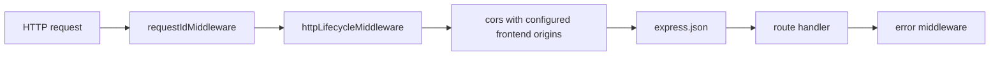

# Backend service

The backend is an Express 5 service in TypeScript, run with `tsx` in development and compiled with `tsc` for production. It has four responsibilities: serve static protected-pool configuration, compute a deterministic risk estimate, sign EIP-712 policies when the signing gate is open, and ingest logs and telemetry for correlation. It never holds user funds and never sends a transaction.

Source: `backend/src`. Entry point: [backend/src/server.ts](../../backend/src/server.ts). Package manifest: [backend/package.json](../../backend/package.json).

## Module layout

| Module | Files | Responsibility |
| --- | --- | --- |
| Configuration | `config/runtimeConfig.ts`, `config/env.ts` | Validates every startup variable, pins the deployment, derives the pool id. `env.ts` owns the alias precedence for variables that were renamed |
| HTTP errors | `http/apiError.ts` | Builds every 400, 404, 500 and 503 body from one place so status, `code`, `error` and `requestId` stay in sync |
| Risk | `risk/riskEngine.ts`, `risk/riskPreview.ts` | The closed-form estimate and the request schema for `/risk-preview` |
| Policy | `policy/policy.ts`, `policy/policyGenerator.ts`, `policy/policyRequest.ts`, `policy/policySigning.ts` | The policy value type, the request schema for `/policy`, policy assembly, and the guarded signing call |
| EIP-712 | `policy/eip712.ts` | The single off-chain declaration: domain name and version, ordered field list, type string, type hash |
| Signer | `signer/policySigner.ts` | `signTypedData` over the shared declaration |
| Signer diagnostics | `backend/scripts/testSigner.ts`, `backend/scripts/verifyApiSignature.ts` | Standalone scripts with their own npm scripts. Outside `src/`, so never compiled |
| Monitor | `monitor/sepolia.ts` | 12-second poll of registry and hook logs, receipt lookup, correlation |
| Observability | `observability/logger.ts`, `observability/requestCorrelation.ts` | Structured JSON logging and the policy-id to request-id map |
| Middleware | `middleware/requestId.ts`, `middleware/httpLifecycle.ts` | Request id assignment and per-request completion logging |

The two diagnostic scripts now live under `backend/scripts/`, outside the `src` root that `tsc` compiles, so they are excluded from the build by location rather than by an explicit `exclude` entry ([backend/tsconfig.json](../../backend/tsconfig.json#L12)). They import the shared EIP-712 declaration rather than re-declaring the field list, but both still target chain id `31337`, so they exercise a local Anvil deployment rather than Sepolia. They are run through `npm run signer:test` and `npm run signer:verify`.

## Request pipeline



`requestIdMiddleware` accepts an `x-request-id` header matching `^[A-Za-z0-9._:-]{1,128}$` and otherwise generates a UUID. It stores the id on `res.locals.requestId` and echoes it in the response header ([backend/src/middleware/requestId.ts:6](../../backend/src/middleware/requestId.ts#L6)).

`httpLifecycleMiddleware` logs one `http_request` record per completed response with method, path, status and duration ([backend/src/middleware/httpLifecycle.ts:5](../../backend/src/middleware/httpLifecycle.ts#L5)).

CORS allows the comma-separated origins in `FRONTEND_URL` (defaulting to `http://localhost:5173` outside production) and exposes `x-request-id`. The first origin is the SIWE authentication domain; production startup requires it.

The JSON body limit is the Express default. A malformed JSON body is caught by the final error middleware and answered with 400, `code: "invalid_json"`, and the request id ([backend/src/server.ts:363](../../backend/src/server.ts#L363)).

Every failure response is built by `sendApiError` in `http/apiError.ts`, so status, machine-readable `code`, human-readable `error` and `requestId` are produced in one place ([backend/src/http/apiError.ts:54](../../backend/src/http/apiError.ts#L54)). A terminal handler registered after all routes answers an unknown path or undeclared method with 404 and `code: "not_found"` in that same shape, rather than Express's default HTML page ([backend/src/server.ts:346](../../backend/src/server.ts#L346)). Success bodies are not routed through the helper and are unchanged. See [API reference](../api/reference.md#error-body-shape).

## Startup requirements

`loadAppDependencies` runs before the listener starts and throws on any configuration error, so the process exits rather than serving a misconfigured deployment ([backend/src/server.ts:55](../../backend/src/server.ts#L55)).

Startup requires, in order:

1. `CHAIN_ID` present and equal to `11155111`. Anything else throws ([backend/src/config/runtimeConfig.ts:79](../../backend/src/config/runtimeConfig.ts#L79)).
2. The six `PROTECTED_POOL_*` variables present, well formed, in ascending currency order, with a 32-byte `PROTECTED_POOL_ID` ([backend/src/config/runtimeConfig.ts:69](../../backend/src/config/runtimeConfig.ts#L69)).
3. The pool id recomputed from the pool key, and compared to the configured id. A mismatch throws ([backend/src/config/runtimeConfig.ts:93](../../backend/src/config/runtimeConfig.ts#L93)).
4. The whole pool key and derived id compared to the legacy Sepolia pins, unless the complete replacement pin set is explicitly enabled with `MEVSHIELD_V2_DEPLOYMENT_VERIFIED=true`. The replacement path still validates the configured hook and independently supplied Pool ID.
5. A verifier address from any of `POLICY_VERIFIER_ADDRESS`, `VERIFIER_ADDRESS`, `POLICY_VERIFIER`, compared to the pinned verifier. A mismatch throws ([backend/src/config/runtimeConfig.ts:180](../../backend/src/config/runtimeConfig.ts#L180)).
6. A router address from `ROUTER_ADDRESS` or `MEVSHIELD_ROUTER`, compared to the active router pin. Conflicting aliases throw rather than silently selecting one.
7. `SIGNER_PRIVATE_KEY`, but only when signing is enabled. The derived address must equal the pinned signer ([backend/src/config/runtimeConfig.ts:195](../../backend/src/config/runtimeConfig.ts#L195) to [backend/src/config/runtimeConfig.ts:210](../../backend/src/config/runtimeConfig.ts#L210)).
8. `REDIS_URL` in production. Startup connects to Redis before binding the HTTP listener; missing or unavailable Redis is fatal. Local development may omit it and uses process-local memory state.

`SIGNER_PRIVATE_KEY` being optional when signing is disabled is the reason the process can run in a read-only configuration. Error messages never include the key material, and `runtimeConfig.test.ts` asserts that.

The monitor starts during dependency loading, not on the first request ([backend/src/server.ts:75](../../backend/src/server.ts#L75)). It is started once and memoised, so repeated calls return the same snapshot function ([backend/src/monitor/sepolia.ts:62](../../backend/src/monitor/sepolia.ts#L62)).

The listener binds `0.0.0.0` on `PORT`, defaulting to 4000 ([backend/src/server.ts:372](../../backend/src/server.ts#L372)). `startServer` logs a warning when local demo signing is on, naming the 1-base-unit minimum as not meaningful slippage protection ([backend/src/server.ts:388](../../backend/src/server.ts#L388)).

## Fail-closed Sepolia pinning

The backend is pinned to one deployment. This is deliberate and it is the main safety property of the service. Replacement Sepolia pins can be supplied only when `MEVSHIELD_V2_DEPLOYMENT_VERIFIED=true`; this flag is an operator assertion after successful preflight, not a backend on-chain verification.

| Pinned constant | Value | Enforced against |
| --- | --- | --- |
| `SEPOLIA_CHAIN_ID` | `11155111` | `CHAIN_ID` and the monitor's `eth_chainId` |
| Default Sepolia pins | Existing source constants | Used unless replacement pinning is explicitly enabled |
| `MEVSHIELD_SEPOLIA_*_ADDRESS` | Required replacement signer, verifier, router, registry, authorization, and hook | Compared with corresponding environment configuration when replacement pinning is enabled |
| `MEVSHIELD_SEPOLIA_POOL_ID` | Required replacement pool ID | Compared with the configured, recomputed Pool ID |
| `MEVSHIELD_V2_DEPLOYMENT_VERIFIED` | `false` unless explicitly set | Allows replacement values only after a separate read-only deployment preflight |

The constants are declared at [backend/src/config/runtimeConfig.ts:9](../../backend/src/config/runtimeConfig.ts#L9) to [backend/src/config/runtimeConfig.ts:22](../../backend/src/config/runtimeConfig.ts#L22).

Consequences a reader should internalise:

- The backend rejects a replacement pin set unless the explicit verification flag and every required pin are present.
- A stale environment file is a startup failure, not a degraded mode. That is the intent.
- The verification flag does not query Sepolia; run the read-only deployment preflight before setting it. The frontend has its own execution gate.

The pool configuration is exposed to clients through `GET /config/protected-pool`, which reports `configurationStatus: "valid"` and `poolReadiness: "not-checked"` ([backend/src/config/runtimeConfig.ts:120](../../backend/src/config/runtimeConfig.ts#L120)). The `not-checked` value is not a placeholder for an unimplemented check that would return `ready`: this route does not read the pool. Pool readiness for the trade page is still assessed by the frontend from RPC reads. `runtimeConfig.test.ts` has a test asserting the response does not claim the pool is initialised or liquid. `/risk-preview` and `/policy` do read `slot0` and active liquidity, and only for the price-impact estimate below.

## Policy signing gate

Sepolia signing is enabled by `resolvePolicySigningEnabled` only when both `MEVSHIELD_V2_POLICY_ENABLED` and `MEVSHIELD_V2_DEPLOYMENT_VERIFIED` are exactly `"true"`, or when the explicitly gated local demo mode is on. The verified-deployment path also requires complete matching address and pool pins before the server starts.

Local demo mode requires `MEVSHIELD_SEPOLIA_DEMO_ENABLED=true`, `NODE_ENV` not equal to `production`, and `RAILWAY_ENVIRONMENT_NAME` unset ([backend/src/config/runtimeConfig.ts:145](../../backend/src/config/runtimeConfig.ts#L145)). Demo mode therefore cannot be enabled on Railway or in a production build by setting the flag alone.

When signing is disabled, `POST /policy` answers 503 before reading the body, so a disabled endpoint returns 503 for every body including an invalid one ([backend/src/server.ts:144](../../backend/src/server.ts#L144)). This ordering is deliberate and is covered by two tests in `server.test.ts`, one with an empty body and one with a valid body.

When signing is enabled, the route performs these steps in order:

1. Parse the body with `PolicyRequestSchema`.
2. In demo mode, require `minAmountOut` to be exactly `"1"`; outside demo mode, reject `minAmountOut` of `"1"` ([backend/src/server.ts:188](../../backend/src/server.ts#L188), [backend/src/server.ts:201](../../backend/src/server.ts#L201)).
3. Require a signer wallet, else 503.
4. Require the requested pool id to equal the configured protected pool id, else 400.
5. Require the requested trader to equal the configured router, else 400.
6. Log `risk_analysis_started`.
7. Read the protected pool's `slot0` and active liquidity ([backend/src/server.ts:258](../../backend/src/server.ts#L258)). A failed read returns 503 `pool_state_unavailable` and does not sign.
8. `generatePolicy` to compute `maxLoss` and `maxFee` from that pool state.
9. Log `risk_analysis_completed` and `policy_created`.
10. `signProtectedPolicy`, which re-asserts the pool id before signing, then logs `policy_signed`.
11. Derive `policyId` and record the request id correlation.
12. Respond with the policy, the signature, the risk fields, `policyId`, `requestId` and `demoMode`.

A Zod error is answered with 400. `PoolStateUnavailableError` is answered with 503 and the error message. Any other thrown error after step 1 is logged as `policy_request_failed` and answered with 500 plus `{ "error": "Internal error", "code": "internal_error", "requestId": … }` ([backend/src/server.ts:337](../../backend/src/server.ts#L337)).

## Risk model

`calculateRisk` quotes price impact from the current pool's active liquidity ([backend/src/risk/riskEngine.ts:81](../../backend/src/risk/riskEngine.ts#L81)). Callers pass `sqrtPriceX96`, `liquidity`, and `feePips` from the pool read. The function does not read the mempool, compare transactions, or detect a sandwich. It does not fall back to `amount / 1000`.

```text
amount = abs(amountSpecified)
fee = amount * feePips / 1_000_000
amountIn = amount - fee
estimatedFee = fee

zeroForOne (token0 in, price down):
  nextSqrt = ceil(L * 2^96 * sqrtP / (L * 2^96 + amountIn * sqrtP))
  amountOut = L * (sqrtP - nextSqrt) / 2^96
  outputValueInInput = amountOut * 2^96 / sqrtP * 2^96 / sqrtP

oneForZero (token1 in, price up):
  nextSqrt = sqrtP + amountIn * 2^96 / L
  amountOut = L * 2^96 * (nextSqrt - sqrtP) / (nextSqrt * sqrtP)
  outputValueInInput = amountOut * sqrtP / 2^96 * sqrtP / 2^96

estimatedLoss = amountIn - outputValueInInput
lossBps = estimatedLoss * 10_000 / amount
maxLoss = estimatedLoss * 2
maxFee = estimatedFee * 2
```

`L` is active liquidity and `sqrtP` is `sqrtPriceX96`. `estimatedLoss` is only the curvature shortfall against the spot price, in input-token units. Integer division rounds the quoted output value down. `zeroForOne` chooses the direction. The level is `LOW` when `lossBps <= 10`, `MEDIUM` when `lossBps <= 50`, and `HIGH` when `lossBps > 50`. If active liquidity cannot support the trade, `estimatedLoss` is the full input and the level is `HIGH`.

The frontend validator accepts `LOW`, `MEDIUM`, and `HIGH` ([frontend/src/lib/apiValidation.ts:102](../../frontend/src/lib/apiValidation.ts#L102)).

The same function feeds `/risk-preview`, which returns the estimate directly, and `/policy`, which writes `maxLoss` and `maxFee` into the signed policy. Those caps are twice the estimates. The hook compares them with the numbers the caller puts in `hookData`. It does not measure this loss. The response `model` is `active-liquidity-impact`. The disclaimer says the estimate uses the current pool state for this trade size and does not read the mempool or detect sandwich attacks.

## Signing

`signPolicy` calls `wallet.signTypedData` with the domain and the field list from the shared EIP-712 module ([backend/src/signer/policySigner.ts:17](../../backend/src/signer/policySigner.ts#L17)). `policyDomain` fixes the name `MEVShield`, the version `1`, and passes through the chain id and verifying contract; `POLICY_TYPES` is the ordered ten-field list ([backend/src/policy/eip712.ts:28](../../backend/src/policy/eip712.ts#L28), [backend/src/policy/eip712.ts:49](../../backend/src/policy/eip712.ts#L49)).

That declaration is the only one in the backend. `policy/eip712.test.ts` parses the `POLICY_TYPEHASH` string literal out of `src/PolicyVerifier.sol` and asserts the derived type string and hash match it, and pins the hash to a literal, so the off-chain type cannot drift from the on-chain one silently ([backend/src/policy/eip712.test.ts:26](../../backend/src/policy/eip712.test.ts#L26), [backend/src/policy/eip712.test.ts:53](../../backend/src/policy/eip712.test.ts#L53)). `policySigning.test.ts` separately asserts that `minAmountOut` is part of the signed digest.

`signProtectedPolicy` wraps the signer with a pool-id assertion, so even a caller that bypasses the route cannot obtain a signature for a foreign pool ([backend/src/policy/policySigning.ts:24](../../backend/src/policy/policySigning.ts#L24)).

The signing key is loaded into memory once at startup as an ethers `Wallet`. There is no KMS, HSM or remote signer integration. Restarting the process reloads it from the environment.

## Observability

`logEvent` writes one JSON object per line to stdout or stderr depending on level ([backend/src/observability/logger.ts:20](../../backend/src/observability/logger.ts#L20)). Every record carries `service`, `environment`, `timestamp`, `level` and `event`, plus caller fields. Bigints are stringified. `LOG_LEVEL` filters records by a weight table, defaulting to `info`, and an unrecognised level falls back to `info`.

`requestCorrelation.ts` keeps an in-memory map from `policyId` to `requestId`, lowercased, with a one-hour TTL and a 10,000-entry ceiling that evicts the oldest entry when full ([backend/src/observability/requestCorrelation.ts:8](../../backend/src/observability/requestCorrelation.ts#L8)). The map is process-local and is lost on restart. It is also the mechanism by which a later `SwapPolicyEnforced` log is attributed back to the HTTP request that produced the policy.

## Known limitations

These are behaviours of the current code that a reader should not have to discover by testing.

- `/policy` requires a wallet-authenticated, short-lived SIWE session. Nonce verification binds the signature to the configured application domain and configured chain, consumes the nonce on first verification attempt, and binds the session wallet to `policy.trader`. Nonce and verification endpoints, plus `/policy`, have socket-IP limits; `/policy` also has a wallet limit.
- Authentication nonces and sessions, rate-limit counters, and the 15-second protected quote authorization cache use Redis in production. Atomic Redis scripts consume nonces once and update rate counters across replicas. Redis TTLs expire nonce/session/rate/quote entries; a Redis outage fails closed with 503 for affected operations. The in-memory implementation is for local development and tests only.
- Configure Railway's `REDIS_URL` with its private Redis connection URL. The URL is a secret and must not be added to Vite variables or committed. Redis availability is required to start every production instance.
- Socket IP is taken from the TCP connection. Forwarded IP headers are deliberately ignored; on Railway this can aggregate traffic behind proxy addresses and reduce per-client accuracy.
- Production startup requires `FRONTEND_URL`; its first comma-separated origin is the SIWE domain and URI. The frontend authenticates by requesting a one-time message, calling the connected wallet's `signMessage`, and exchanging that signature for a bearer session before requesting `/policy`.
- No request-size or numeric bound beyond the schema. `amountSpecified` and `expiry` are bounded by regex and by the 30-minute expiry window; `poolId` and `trader` are regex-checked hex.
- The frontend requests a 10-minute lifetime through `buildPolicyExpiry`, which stays inside the backend's 30-minute ceiling ([frontend/src/config/policy.ts:23](../../frontend/src/config/policy.ts#L23), [backend/src/policy/policyRequest.ts:6](../../backend/src/policy/policyRequest.ts#L6)). The ceiling is short on purpose: it bounds the replay window for a signed policy. The frontend mirrors the ceiling as a local constant rather than importing it, so the two values could drift in principle; `frontend/src/config/policy.test.mjs` fails when the requested TTL reaches or exceeds the mirrored ceiling. See [data model](../architecture/data-model.md#nonce-lifecycle).
- `generatePolicy` has no direct unit test. It is exercised only through the route tests, and only up to the point where a signer would be required.
- The risk model is a within-tick quote. It does not walk neighboring ticks, read the mempool, or detect a sandwich. A trade that leaves the current range can cost more than the estimate. A failed pool read fails the request; it does not invent a loss from the amount alone.
- The monitor is fail-open for policy correlation. If the monitor is disabled or erroring, the swap still happens; only the correlation log is missing. See [monitoring](monitoring.md).

## Running the service

```
cd backend
npm ci
npm run dev     # tsx src/server.ts
npm run demo    # tsx with NODE_ENV=development and MEVSHIELD_SEPOLIA_DEMO_ENABLED=true
npm test        # the files named in backend/package.json
npm run build   # tsc, output to backend/dist
npm start       # node dist/server.js
```

`npm run demo` sets the demo flag inline, so it still requires the rest of the pinned configuration to be present and correct. It does not bypass the Sepolia pinning.

Deployment: [railway.json](../../railway.json) sets the build command to install and build the backend and the start command to `npm --prefix backend start`, with `/health` as the health check path.

## Related pages

- [API reference](../api/reference.md).
- [Configuration](../operations/configuration.md).
- [Monitoring](monitoring.md).
- [ADR 0004](../decisions/0004-fail-closed-sepolia-configuration.md).
