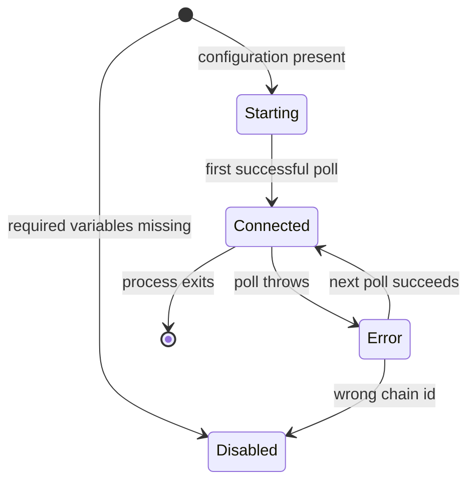

# Monitoring and observability

This page covers the Sepolia log monitor, the structured logging format, and the request correlation map. It also states plainly where the monitor fails open.

Source: [backend/src/monitor/sepolia.ts](../../backend/src/monitor/sepolia.ts), [backend/src/observability/logger.ts](../../backend/src/observability/logger.ts), [backend/src/observability/requestCorrelation.ts](../../backend/src/observability/requestCorrelation.ts).

## What the monitor is

A poll loop that reads registry and hook event logs from Sepolia, attributes each one to an HTTP request when it can, and looks up the transaction receipt to record gas and status. It writes JSON log lines. It does not write to a database, does not expose a metrics endpoint, and does not alert.

It is the only component that connects an on-chain swap back to the HTTP request that produced the policy.

## Lifecycle

`startSepoliaMonitor` is memoised. The first call does the configuration work and starts the interval; every later call returns a snapshot closure over the same state ([backend/src/monitor/sepolia.ts:58](../../backend/src/monitor/sepolia.ts#L58)).

The first poll runs immediately with `void poll()`, and the interval is `setInterval` at 12,000 ms ([backend/src/monitor/sepolia.ts:327](../../backend/src/monitor/sepolia.ts#L327), [backend/src/monitor/sepolia.ts:328](../../backend/src/monitor/sepolia.ts#L328)). The timer is `unref`'d, so it does not by itself keep the process alive.

## Configuration resolution

| Purpose | Accepts, in order |
| --- | --- |
| RPC endpoint | `SEPOLIA_RPC_URL`, `RPC_URL` |
| Registry | `POLICY_REGISTRY_ADDRESS`, `POLICY_REGISTRY` |
| Hook | `HOOK_ADDRESS`, `MEVSHIELD_HOOK_ADDRESS` |
| Router, optional | `ROUTER_ADDRESS`, `MEVSHIELD_ROUTER` |

Resolution is at [backend/src/monitor/sepolia.ts:68](../../backend/src/monitor/sepolia.ts#L68) to [backend/src/monitor/sepolia.ts#L83](../../backend/src/monitor/sepolia.ts#L83).

Behaviour by configuration state:

| State | Result |
| --- | --- |
| RPC, registry or hook missing | Status `disabled`, one `sepolia_monitor_disabled` warning naming the missing variables, no polling ([backend/src/monitor/sepolia.ts:93](../../backend/src/monitor/sepolia.ts#L93)) |
| Registry or hook not an address | Throws during startup, so the process fails to start ([backend/src/monitor/sepolia.ts:102](../../backend/src/monitor/sepolia.ts#L102)) |
| Router present but not an address | Throws during startup ([backend/src/monitor/sepolia.ts:104](../../backend/src/monitor/sepolia.ts#L104)) |
| Router absent | Polling proceeds; the router field in swap logs is omitted or taken from the receipt |

A malformed optional router aborting startup is a deliberate fail-closed choice: a typo in an optional variable is treated as a configuration error rather than silently ignored. `sepolia.test.ts` covers both the malformed and the missing case.

Note that the monitor uses environment variables directly rather than the validated `ProtectedPoolConfig` from `runtimeConfig.ts`. Its addresses are not compared to the pinned deployment. The chain id is pinned, but the registry and hook addresses are trusted as configured. A misdirected monitor would scan the wrong contracts rather than refuse to start.

## What is ingested

Two event topics, from two addresses, in one `getLogs` call per block range ([backend/src/monitor/sepolia.ts:303](../../backend/src/monitor/sepolia.ts#L303)).

| Event | Emitted by | Fields |
| --- | --- | --- |
| `PolicyRegistered(bytes32 indexed policyId, bytes32 indexed poolId, address indexed trader, uint256 nonce, uint256 expiry, uint256 maxLoss, uint256 maxFee, uint256 minAmountOut)` | `PolicyRegistry` | All eight |
| `SwapPolicyEnforced(bytes32 indexed poolId, address indexed trader, uint256 nonce, uint256 maxLoss, uint256 maxFee)` | `MEVShieldHook` | Five; no amounts |

The interfaces are declared inline at [backend/src/monitor/sepolia.ts:19](../../backend/src/monitor/sepolia.ts#L19) and [backend/src/monitor/sepolia.ts:23](../../backend/src/monitor/sepolia.ts#L23). A decoded log becomes a `sepolia_contract_event` record carrying the event name, contract address, block number, transaction hash, log index, policy id, pool id, trader, nonce, and the event-specific extra fields ([backend/src/monitor/sepolia.ts:178](../../backend/src/monitor/sepolia.ts#L178)).

For a `SwapPolicyEnforced` log the policy id is recomputed as `keccak256(poolId, trader, nonce)`, because the event does not carry it ([backend/src/monitor/sepolia.ts:169](../../backend/src/monitor/sepolia.ts#L169)).

### Block scanning

The monitor tracks `lastScannedBlock`. On the first successful poll it sets `fromBlock` to the current head, so it starts at the head and does not backfill history. On later polls it reads `lastScannedBlock + 1` to the head ([backend/src/monitor/sepolia.ts:296](../../backend/src/monitor/sepolia.ts#L296)).

A consequence worth stating: a monitor restart skips every block between the last run and the new head. There is no persistent cursor, and there is no backfill on startup. Log records for that window are lost.

`pollRunning` guards against overlapping polls, and `stopped` prevents a poll from running after shutdown ([backend/src/monitor/sepolia.ts:255](../../backend/src/monitor/sepolia.ts#L255)).

### Chain check

Every poll calls `eth_chainId` first and compares it to `11155111`. A mismatch sets status to `error`, logs `sepolia_monitor_wrong_chain` with both values, and stops the monitor ([backend/src/monitor/sepolia.ts:261](../../backend/src/monitor/sepolia.ts#L261) to [backend/src/monitor/sepolia.ts#L270](../../backend/src/monitor/sepolia.ts#L270)). `sepolia.test.ts` asserts that only `eth_chainId` is called in this case, so no block or log request is made against the wrong chain.

The provider is constructed with `staticNetwork: true` so ethers does not perform its own chain detection ([backend/src/monitor/sepolia.ts:113](../../backend/src/monitor/sepolia.ts#L113)).

### Receipt lookup

When a log's policy id resolves to a known request id, the monitor fetches the transaction receipt and logs a confirmation record.

| Event | Confirmation record | Extra fields |
| --- | --- | --- |
| `PolicyRegistered` | `policy_registration_confirmed` | request id, tx hash, block, gas used, status, registry address, nonce |
| `SwapPolicyEnforced` | `swap_confirmed` | request id, tx hash, block, gas used, status, router, hook, nonce |

`swap_confirmed` also clears the correlation entry, because a swap consumes its policy ([backend/src/monitor/sepolia.ts:241](../../backend/src/monitor/sepolia.ts#L241)). A failed receipt lookup logs `sepolia_receipt_lookup_failed` with the error name and message truncated to the thrown message.

A receipt that is not yet available is treated as a failure, not retried ([backend/src/monitor/sepolia.ts:212](../../backend/src/monitor/sepolia.ts#L212)). Because the poll reads logs for blocks that are already mined, this is rare, but it is not impossible on a reorg.

### Status reporting

The snapshot exposed through `GET /health` carries `status` and, once a block has been scanned, `lastCheckedBlock` ([backend/src/monitor/sepolia.ts:331](../../backend/src/monitor/sepolia.ts#L331)). The Network page renders both and warns that a block number that stops advancing means the monitor is stalled ([frontend/src/pages/NetworkPage.tsx:115](../../frontend/src/pages/NetworkPage.tsx#L115)).

## Correlation ids

Correlation is a process-local `Map` from lowercased policy id to a request id with a one-hour expiry ([backend/src/observability/requestCorrelation.ts:8](../../backend/src/observability/requestCorrelation.ts#L8)).

| Function | Purpose |
| --- | --- |
| `trackPolicyRequest(policyId, requestId)` | Called from `POST /policy` after signing. Prunes expired entries, evicts the oldest when at 10,000 entries, then stores the mapping |
| `requestIdForPolicy(policyId)` | Called by the monitor. Returns `undefined` when absent or expired, and deletes an expired entry |
| `clearPolicyRequest(policyId)` | Called after a swap confirmation |

The request id itself originates in `requestIdMiddleware`: the client's `x-request-id` header when it matches the allowed pattern, otherwise a generated UUID ([backend/src/middleware/requestId.ts:6](../../backend/src/middleware/requestId.ts#L6)). The frontend generates its own id with `crypto.randomUUID()` and sends it on both the policy request and the telemetry posts ([frontend/src/lib/observability.ts:1](../../frontend/src/lib/observability.ts#L1)), then asserts that the id echoed back in the response header matches the one it sent ([frontend/src/hooks/usePolicy.ts:389](../../frontend/src/hooks/usePolicy.ts#L389)).

A `sepolia_contract_event` for an untracked policy carries no `requestId` field at all, because the field is spread conditionally ([backend/src/monitor/sepolia.ts:178](../../backend/src/monitor/sepolia.ts#L178)).

## Known fail-open behaviour

The monitor does not gate anything. If it is disabled, erroring, or restarted, three things happen and nothing else.

1. On-chain events are not recorded in the backend log.
2. A swap that would otherwise be attributed to its HTTP request is logged without a request id, or not at all.
3. `GET /health` reports `sepoliaMonitor.status` of `disabled` or `error`.

The policy registration, the swap, and the nonce consumption all proceed normally. There is no health check that marks the service unhealthy because the monitor is down, and the Railway health check path is `/health`, which returns 200 with `status: "ok"` regardless of monitor state ([backend/src/server.ts:104](../../backend/src/server.ts#L104)). A deployment with a permanently disabled monitor looks healthy to the platform.

Within the monitor itself, three narrower fail-open paths:

- An undecodable log is logged as `sepolia_event_decode_failed` and skipped. Processing continues with the next log ([backend/src/monitor/sepolia.ts:156](../../backend/src/monitor/sepolia.ts#L156)).
- A missing request id skips the receipt lookup entirely, so no gas or status record is produced for that event ([backend/src/monitor/sepolia.ts:204](../../backend/src/monitor/sepolia.ts#L204)).
- A poll error sets status to `error` and the next poll is attempted on schedule. Persistent failures produce one `sepolia_monitor_error` record per poll, roughly one every 12 seconds, with no backoff and no alert.

The monitor is therefore a diagnostic aid, not a control. Treating `lastCheckedBlock` as evidence that a swap was recorded would be wrong when the monitor was down for that block range.

## Structured logging

`logEvent(level, event, fields)` writes one JSON object per line ([backend/src/observability/logger.ts:19](../../backend/src/observability/logger.ts#L19)).

| Field | Always present |
| --- | --- |
| `service` | `mevshield-backend` |
| `environment` | `NODE_ENV`, default `development` |
| `timestamp` | ISO 8601 |
| `level` | `debug`, `info`, `warn` or `error` |
| `event` | Caller-supplied event name |

Output goes to `console.info`, `console.warn`, `console.error` or `console.debug` by level, so the platform's stream separation applies. Bigint values are stringified through a JSON replacer, which is why every numeric field in a log record is a string.

Level filtering uses a weight table and `LOG_LEVEL`, defaulting to `info`. An unrecognised value falls back to `info` rather than failing startup.

### Event catalogue

| Event | Level | Emitted from |
| --- | --- | --- |
| `backend_started` | info | Server listener callback |
| `local_sepolia_demo_signing_enabled` | warn | `startServer` when demo mode is on |
| `http_request` | info | Lifecycle middleware, once per response |
| `risk_analysis_started` | info | `POST /policy` after validation |
| `risk_analysis_completed` | info | After `generatePolicy` |
| `policy_created` | info | With the full policy fields |
| `policy_signed` | info | After signing, with signer address and nonce |
| `policy_request_failed` | error | `POST /policy` catch block |
| `sepolia_monitor_disabled` | warn | Monitor, missing configuration |
| `sepolia_monitor_connected` | info | First successful poll |
| `sepolia_monitor_reconnected` | info | Recovery from `error` |
| `sepolia_monitor_error` | error | Poll failure, with a `recoveredConnectionLost` flag when the previous status was `connected` |
| `sepolia_monitor_wrong_chain` | error | Chain id mismatch, then stop |
| `sepolia_new_block` | info | Head advanced |
| `sepolia_contract_event` | info | Each decoded log |
| `sepolia_event_decode_failed` | warn | Undecodable log |
| `sepolia_receipt_lookup_failed` | error | Receipt fetch failure |
| `policy_registration_confirmed` | info | Registration receipt |
| `swap_confirmed` | info | Swap receipt |

The client also posts four transaction events to `POST /observability/transaction`: `policy_registration_submitted`, `policy_registration_failed`, `swap_submitted`, `swap_failed`. These are logged under their own names at `error` when the name ends in `_failed` and `info` otherwise ([backend/src/server.ts:310](../../backend/src/server.ts#L310)). That route has no authentication and no rate limit; any client can write arbitrary events into the backend log stream, subject only to the schema.

## Frontend logging

The frontend logs JSON lines to the browser console with `service: "mevshield-frontend"` and the Vite `MODE` as the environment ([frontend/src/lib/observability.ts:9](../../frontend/src/lib/observability.ts#L9)). Events: `swap_started`, `policy_response`, `transaction_submitted`, `transaction_confirmed`, `transaction_failed`, `protected_swap_execution_started`, `telemetry_delivery_failed`.

`safeError` redacts hex blobs of 80 characters or more and truncates to 240 characters before anything is logged or posted ([frontend/src/lib/observability.ts:24](../../frontend/src/lib/observability.ts#L24)). There is no remote log sink: frontend logs stay in the browser, and the only server-side record is whatever the client volunteers through the telemetry route.

## What is not implemented

- No metrics endpoint and no Prometheus or OpenTelemetry export.
- No alerting on monitor status, poll errors, signing failures or swap failures.
- No health endpoint that reflects monitor state in its HTTP status.
- No persistent cursor or block backfill, so restart gaps are permanent.
- No reorg handling. A log observed at a block that is later reorganised out is logged as confirmed and never corrected.
- No rate limit or authentication on the telemetry route.

## Related pages

- [Backend service](../services/backend.md).
- [API reference](../api/reference.md) for the `/health` and `/observability/transaction` schemas.
- [Configuration](../operations/configuration.md).
